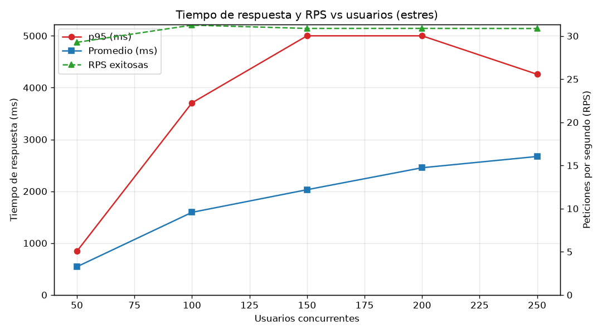
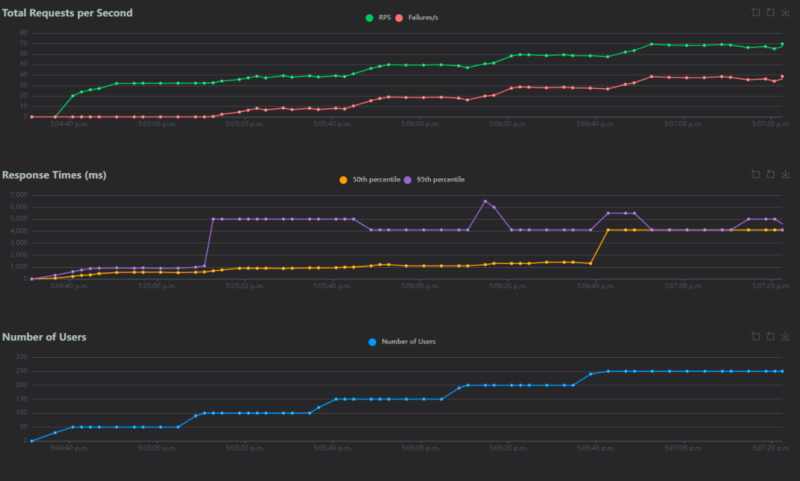
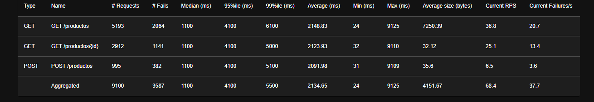
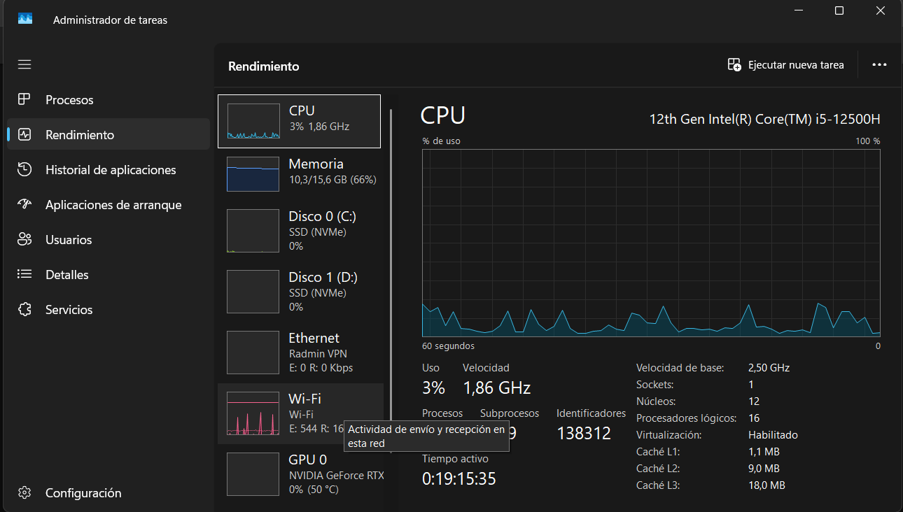
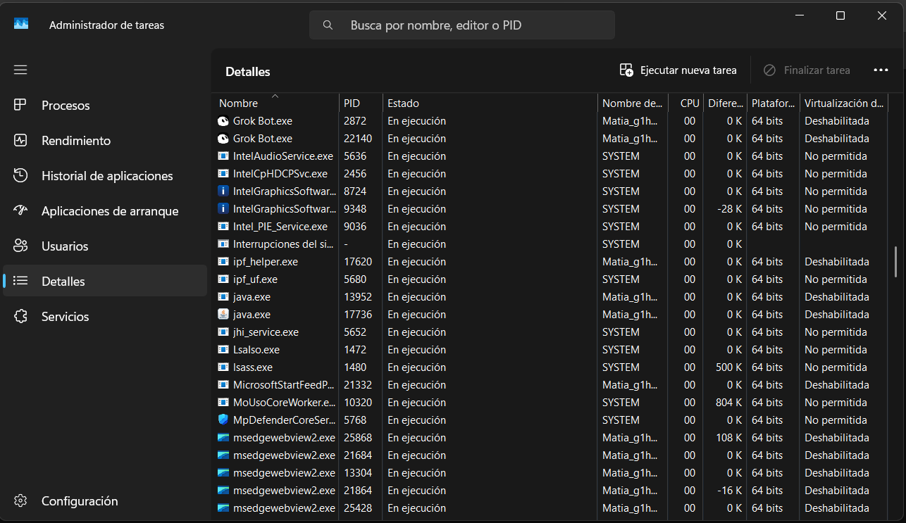

# TP10 - Monitoreo, Pruebas de Carga y Evaluación de Desempeño

- **Alumno:** Matías Ríos
- **Materia:** Desarrollo de Aplicaciones para Ambientes Distribuidos
- **Cátedra:** Lic. Gabriel Artaza
- **Unidad:** Unidad 4 - Evaluación del desempeño, Monitoreo y Optimización
- **Herramientas:** Java `com.sun.net.httpserver.HttpServer` (servicio), Python **Locust** (generación de carga), **psutil** (monitoreo de CPU/RAM), matplotlib (gráfico)

## Descripción

Se diseñó y ejecutó un plan de pruebas de **carga** y de **estrés** sobre la **API REST de Catálogo de Productos del TP7**, para medir latencia, rendimiento (RPS), tasa de errores y consumo de recursos, e identificar el cuello de botella de la arquitectura. Después se aplicó una optimización (pool de hilos) y se repitió la prueba para comparar.

## Descripción del entorno

| Componente | Detalle |
|---|---|
| Procesador | Intel Core i5-12500H (12 núcleos / 16 hilos) |
| Memoria RAM | 15,6 GB |
| Sistema operativo | Windows 11 Home |
| Java | JDK 25 |
| Python | 3.14 |
| Herramienta de carga | Locust 2.47 |
| Monitoreo | `monitor_recursos.py` (psutil) + Administrador de tareas de Windows |
| Servicio evaluado | API REST del TP7 (Java, `HttpServer`) en `http://localhost:8080` |
| Despliegue | Local: el servidor, Locust y el monitor corren en la misma PC |

### Endpoints probados

| Método | Ruta | Peso en la prueba | Respuesta esperada |
|---|---|---|---|
| GET | `/productos` | 5 | 200 con la lista |
| GET | `/productos/{id}` (id existente al azar 1..5) | 3 | 200 con el producto |
| POST | `/productos` | 1 | 201 con el producto creado |

### Cambios al servicio del TP7 para esta prueba

El código es el del TP7, con tres cambios mínimos (todos en `servicio/servidor/`):

1. **`--hilos N`** en `ServidorREST`:
   - sin indicar o `N <= 1`: `server.setExecutor(null)`. Es el comportamiento original del TP7: el JDK atiende **todos los pedidos con un único hilo despachador**. Es la **versión sin optimizar**.
   - `N > 1`: `Executors.newFixedThreadPool(N)`, un pool de N hilos que atienden pedidos en paralelo. Es la **versión optimizada**.
2. **`--demora MS`** (por defecto 20 ms): **latencia de E/S simulada**. El servicio del TP7 guarda los productos en memoria, así que cada pedido tarda microsegundos y no representa un sistema real. Para que el cuello de botella sea observable, el handler hace un `Thread.sleep(20)` en cada pedido, que **simula el costo de un acceso a base de datos o a disco**. Durante esa espera el hilo no usa CPU, pero queda bloqueado, igual que con una consulta a una BD real. **Aclaración: esta demora es artificial y está documentada a propósito**; con `--demora 0` el servicio responde sin ella.
3. **Repositorio thread-safe**: `RepositorioProductos` usa `ConcurrentSkipListMap` y `AtomicInteger`, porque en la versión con pool varios hilos leen y escriben al mismo tiempo. Además el catálogo guarda como máximo 200 productos: los POST siguientes se validan y responden 201 igual, pero no se guardan, para que el `GET /productos` no crezca sin fin durante la prueba y sesgue la medición.

## Estructura

```
T.P10/
├── servicio/
│   └── servidor/
│       ├── Producto.java              (modelo + toJson / fromJson)
│       ├── RepositorioProductos.java  (almacenamiento en memoria, thread-safe)
│       ├── ProductoHandler.java       (atiende /productos, demora simulada, errores)
│       └── ServidorREST.java          (main, puerto 8080, --hilos y --demora)
├── locustfile.py                      (plan de pruebas: usuario virtual y tareas)
├── locustfile_estres.py               (rampa de estrés 50 -> 250 usuarios, LoadTestShape)
├── monitor_recursos.py                (registro de CPU/RAM con psutil)
├── analizar_resultados.py             (tabla por usuarios + gráfico a partir de los CSV de Locust)
├── resultados/                        (CSV, HTML y gráficos generados por las pruebas)
├── img/                               (capturas)
├── .gitignore
└── README.md
```

## Plan de pruebas

Configuración común del usuario virtual (`locustfile.py`):

- `wait_time = between(0.5, 1.5)`: cada usuario espera entre 0,5 y 1,5 s entre peticiones, o sea, hace aproximadamente 1 petición por segundo.
- `timeout = 5 s` por petición, con `catch_response=True`: cualquier código distinto al esperado (200/201) y cualquier **timeout** o conexión rechazada se cuenta como **fallo**.

### 1. Prueba de carga normal

| Parámetro | Valor |
|---|---|
| Usuarios concurrentes | 50 |
| Velocidad de alta | 10 usuarios/s |
| Duración | 2 minutos |

### 2. Prueba de estrés (punto de quiebre)

Rampa en escalones definida en `locustfile_estres.py` (`LoadTestShape`), con alta de 10 usuarios/s:

| Escalón | Desde (s) | Hasta (s) | Usuarios |
|---|---|---|---|
| 1 | 0 | 30 | 50 |
| 2 | 30 | 60 | 100 |
| 3 | 60 | 90 | 150 |
| 4 | 90 | 120 | 200 |
| 5 | 120 | 180 | 250 |

Duración total: 3 minutos. La prueba se corre dos veces: con la versión sin optimizar y con la versión optimizada (`--hilos 32`).

### Hipótesis del cuello de botella

Con un solo hilo despachador, los pedidos se atienden **de a uno**. Si cada uno tarda unos 20 ms (E/S simulada), el máximo teórico es **1000 / 20 = ~50 peticiones por segundo**, sin importar cuántos núcleos tenga la PC. Como cada usuario hace aproximadamente 1 petición por segundo, a partir de unos 50 usuarios la demanda supera esa capacidad. Los pedidos se encolan, la latencia crece y, cuando la espera supera los 5 s, aparecen los timeouts. Se espera además que **la CPU quede casi ociosa** (el hilo está bloqueado esperando E/S, no calculando). Eso indica que el límite es el **agotamiento de hilos / bloqueo por E/S** y no el procesador.

Con un pool de 32 hilos, el máximo teórico pasa a ser unos 32 × 50 = 1600 req/s, muy por encima de la demanda de 250 usuarios.

## Cómo ejecutar

Todo se corre desde la carpeta `T.P10` en PowerShell. En Windows el comando `locust` puede no estar en el PATH, por eso se usa siempre `python -m locust`.

**0. Requisitos (una sola vez):**
```
python -m pip install locust psutil matplotlib
```

**1. Compilar el servicio:**
```
javac -encoding UTF-8 -d out servicio\servidor\*.java
```

**2. Levantar el servidor** (terminal 1). Versión sin optimizar:
```
java -cp out servidor.ServidorREST
```
Versión optimizada:
```
java -cp out servidor.ServidorREST --hilos 32
```

**3. Monitorear CPU/RAM** (terminal 2, con el servidor ya levantado). Busca solo el proceso `java` que corre `servidor.ServidorREST`:
```
python monitor_recursos.py --tag carga_normal --duracion 130
```
Al mismo tiempo, tener abierto el **Administrador de tareas** (Ctrl + Shift + Esc, pestaña Rendimiento) para la captura 3.

**4. Lanzar la prueba** (terminal 3).

Carga normal (50 usuarios, 2 minutos):
```
**python -m locust -f locustfile.py --headless -u 50 -r 10 -t 2m --csv resultados\carga_normal --html resultados\carga_normal.html
```

Estrés, versión sin optimizar (en la terminal 2: `python monitor_recursos.py --tag estres --duracion 190`):
```
**python -m locust -f locustfile_estres.py --headless --csv resultados\estres --html resultados\estres.html
```

Estrés, versión optimizada (reiniciar el servidor con `--hilos 32`; en la terminal 2: `python monitor_recursos.py --tag estres_optimizado --duracion 190`):
```
python -m locust -f locustfile_estres.py --headless --csv resultados\estres_optimizado --html resultados\estres_optimizado.html
```

Modo con interfaz web, para las capturas 1 y 2: correr el comando sin `--headless` y abrir `http://localhost:8089`:
```
python -m locust -f locustfile_estres.py
```
(Con `locustfile_estres.py` la rampa arranca sola al tocar **Start**; con `locustfile.py` se cargan a mano 50 usuarios y 10 de velocidad.)

**5. Analizar los resultados:**
```
python analizar_resultados.py carga_normal
python analizar_resultados.py estres --guardar
python analizar_resultados.py estres_optimizado --guardar
```
Muestra los totales (peticiones, fallos, promedio, mínimo, máximo, p90, p95, RPS), la tabla de tiempo de respuesta vs usuarios, el resumen de CPU/RAM y genera `resultados\grafico_<tag>.png`.

Para frenar el servidor, apretar **Ctrl + C** en su terminal antes de cerrarla, así no queda ocupando el puerto 8080.

## Resultados

### Prueba de carga normal (50 usuarios, 2 minutos, versión sin optimizar)

| Métrica | Valor |
|---|---|
| Peticiones totales | 3776 |
| Fallos | 0 (0,00 %) |
| Tiempo de respuesta promedio | 553 ms |
| Mínimo / Máximo | 32 ms / 4361 ms |
| Percentil 90 / 95 | 860 ms / 940 ms |
| Rendimiento (throughput) | 31,7 peticiones/s |
| CPU del sistema (prom. / máx.) | 9,3 % / 26,9 % |
| CPU del proceso java (prom. / máx.) | 0,4 % / 3,3 % |
| RAM del proceso java (prom. / máx.) | 159 MB / 218 MB |

| Endpoint | Peticiones | Fallos | Prom. (ms) | p95 (ms) | RPS |
|---|---|---|---|---|---|
| GET /productos | 2092 | 0 | 554 | 930 | 17,6 |
| GET /productos/{id} | 1268 | 0 | 552 | 930 | 10,6 |
| POST /productos | 416 | 0 | 550 | 970 | 3,5 |

Con 50 usuarios no hay errores, pero el promedio ya es de **553 ms** para pedidos que el servidor resuelve en unos 30 ms: el servidor de un solo hilo ya está trabajando al límite y los pedidos hacen cola. Los 50 usuarios piden unas 50 peticiones/s, pero el servidor solo entrega **~31 peticiones/s**.

### Prueba de estrés (50 a 250 usuarios, versión sin optimizar)

Corrida del 12/11/2026 a las 17:04, la misma de las capturas 1, 2 y 3. Tiempo de respuesta vs cantidad de usuarios concurrentes, tasa de aciertos y errores durante el pico, y uso de recursos:

| Usuarios | Prom. (ms) | p90 (ms) | p95 (ms) | Máx. (ms) | RPS total | RPS exitosas | % fallos |
|---|---|---|---|---|---|---|---|
| 50 | 544 | 733 | 843 | 4400 | 29,3 | 29,3 | 0,00 % |
| 100 | 1594 | 1177 | 3706 | 5100 | 36,3 | 31,3 | 18,68 % |
| 150 | 2031 | 4162 | 5000 | 5100 | 46,2 | 30,9 | 36,80 % |
| 200 | 2454 | 4100 | 5000 | 9100 | 55,4 | 30,9 | 47,37 % |
| 250 | 2672 | 4100 | 4258 | 9100 | 66,7 | 30,9 | 54,86 % |

**Totales de la prueba:** 9277 peticiones, **3696 fallos (39,84 %)**: 355 por timeout (más de 5 s sin respuesta) y 3341 por conexión rechazada, porque se llenó la cola de conexiones pendientes del servidor y Windows rechazó las nuevas. Promedio 2148 ms, mínimo 24 ms, máximo 9125 ms, p90 y p95 de 4100 ms, 51,4 peticiones/s en promedio.

| Endpoint | Peticiones | Fallos | % fallos | Prom. (ms) | p95 (ms) |
|---|---|---|---|---|---|
| GET /productos | 5292 | 2128 | 40,21 % | 2165 | 4100 |
| GET /productos/{id} | 2973 | 1177 | 39,59 % | 2137 | 4100 |
| POST /productos | 1012 | 391 | 38,64 % | 2098 | 4100 |

(La captura 2 se tomó unos segundos antes del final de la rampa, por eso muestra 9100 peticiones en lugar de las 9277 finales.)

**Tasa de aciertos y errores en el pico (250 usuarios):** de 3795 peticiones, 1713 fueron exitosas (**45,14 %**) y 2082 fallaron por timeout o conexión rechazada (**54,86 %**).

**Recursos durante la prueba:** en el Administrador de tareas (captura 3), con 250 usuarios, la CPU de toda la PC estaba en **3 %** y la memoria en 10,3 de 15,6 GB (66 %). En la pestaña Detalles el proceso `java.exe` del servidor figura con **00 % de CPU**. En una corrida anterior igual (10/11/2026) se registró además el consumo con `monitor_recursos.py`:

| Métrica | Promedio | Máximo |
|---|---|---|
| CPU del sistema | 15,2 % | 74,0 % |
| RAM del sistema | 77,7 % | 86,1 % |
| CPU del proceso java | 0,3 % | 3,7 % |
| RAM del proceso java | 179 MB | 230 MB |

El punto de quiebre aparece **entre 50 y 100 usuarios**: a partir de ahí las peticiones exitosas se estancan en **~31 por segundo** sin importar cuántos usuarios se agreguen, la latencia sube de 0,5 s a más de 2,5 s y los errores llegan al 55 %. El "RPS total" sigue subiendo solo porque incluye los pedidos que fallan. Los picos de CPU del sistema corresponden a Locust generando carga, no al servidor: el proceso java nunca pasó del 3,7 %.



### Prueba de estrés con la versión optimizada (`--hilos 32`)

| Usuarios | Prom. (ms) | p90 (ms) | p95 (ms) | Máx. (ms) | RPS exitosas | % fallos |
|---|---|---|---|---|---|---|
| 50 | 26 | 43 | 59 | 170 | 41,8 | 0,00 % |
| 100 | 27 | 34 | 36 | 170 | 86,8 | 0,00 % |
| 150 | 24 | 34 | 36 | 170 | 135,9 | 0,00 % |
| 200 | 24 | 32 | 34 | 170 | 184,2 | 0,00 % |
| 250 | 37 | 39 | 44 | 290 | 234,5 | 0,00 % |

**Totales:** 28646 peticiones, **0 fallos**, promedio 31 ms, mínimo 21 ms, máximo 291 ms, p90 42 ms, p95 47 ms, 158,2 peticiones/s de promedio (234,5 en el pico).

**Recursos:** CPU del sistema 15,8 % promedio (40,3 % máx.), CPU del proceso java 0,8 % (5,6 % máx.), RAM del proceso java 205 MB (243 MB máx.), con 65 a 71 hilos.

**Comparación en el pico de 250 usuarios:**

| Versión | Prom. (ms) | p95 (ms) | Peticiones exitosas/s | % fallos |
|---|---|---|---|---|
| Sin optimizar (1 hilo) | 2672 | 4258 | 30,9 | 54,86 % |
| Optimizada (32 hilos) | 37 | 44 | 234,5 | 0,00 % |

Con el pool de hilos el rendimiento crece en proporción a los usuarios (cada usuario hace ~1 petición/s), la latencia se mantiene estable en unos 30 ms y no hay ningún error: **la versión optimizada no llegó a saturarse con 250 usuarios**.

## Capturas de pantalla

### Captura 1: Locust en ejecución con usuarios virtuales



### Captura 2: Resumen de resultados en Locust



### Captura 3: Administrador de tareas (CPU) durante el punto de quiebre



### Captura 4: Administrador de tareas (Detalles), proceso java.exe del servidor



## Conclusión y cuello de botella

**El límite de la arquitectura es el hilo despachador único del `HttpServer` (agotamiento de hilos por bloqueo de E/S), no el procesador ni la memoria.**

- La versión original atiende los pedidos de a uno. Cada pedido tiene una espera de E/S simulada de 20 ms que en Windows dura en realidad unos 30 ms (por la resolución del temporizador del sistema, de ahí el mínimo de 29 a 33 ms). Por eso el techo medido fue de **~31 peticiones/s**, en lugar de las 50 teóricas.
- Superado ese techo (entre 50 y 100 usuarios) los pedidos se encolan, el tiempo de respuesta crece de forma lineal con la cola y aparecen los errores: primero timeouts (más de 5 s de espera) y después conexiones rechazadas, cuando se llena la cola de conexiones pendientes: **55 % de errores con 250 usuarios**.
- Durante todo ese tiempo el proceso java usó **menos del 4 % de CPU** y unos 200 MB de RAM: el servidor no estaba calculando, estaba **bloqueado esperando**. Eso descarta al procesador y a la memoria como cuello de botella.
- Al aplicar la mejora (pool de 32 hilos), el mismo servicio atendió **234 peticiones/s con 250 usuarios, 37 ms de promedio y 0 % de errores**, con el mismo consumo bajo de CPU. Con 32 hilos el techo teórico pasa a ser de unas 1000 peticiones/s, así que con más usuarios el siguiente límite sería la propia PC, que también corre Locust.

### Propuestas de optimización

1. **Aumentar los hilos (aplicada):** reemplazar el hilo despachador único por un pool (`Executors.newFixedThreadPool`), para que mientras un hilo espera la E/S otros atiendan pedidos.
2. **Caché de `GET /productos`:** es la operación más frecuente (peso 5 de 9) y el catálogo cambia poco. Guardar en memoria el JSON ya armado e invalidarlo en cada POST evitaría el acceso a datos en la mayoría de los pedidos.
3. **Replicación y balanceo de carga:** levantar varias instancias del servicio detrás de un balanceador (por ejemplo Nginx), con lecturas sobre réplicas como en el TP8, para escalar horizontalmente cuando una sola máquina no alcance.
