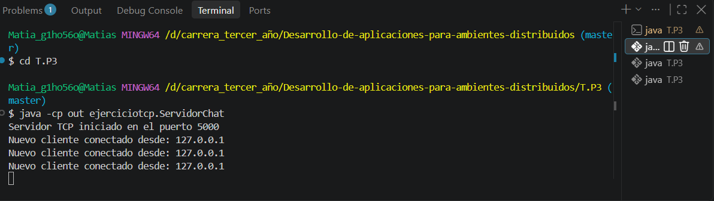
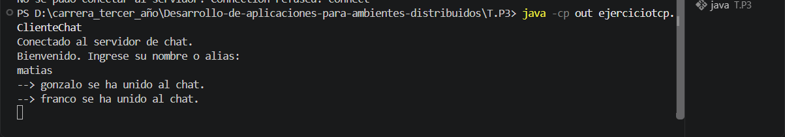
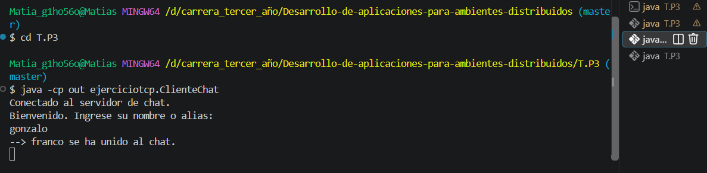
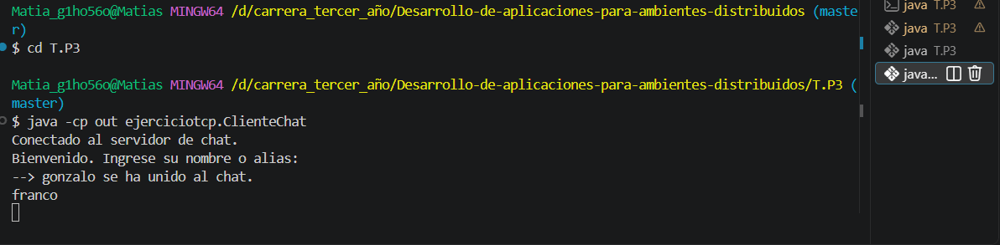

TP3 sockets TCP/UDP 

1. Capa de Transporte

TCP es un protocolo orientado a conexión. Antes de intercambiar datos,
establece una conexión y proporciona una transmisión fiable y ordenada.
Esto permite que los mensajes del chat se transporten mediante un flujo
de bytes.

UDP es un protocolo sin conexión. Envía datagramas de forma independiente
y no garantiza su entrega, orden ni ausencia de duplicados. Su menor
sobrecarga puede resultar conveniente para alertas y telemetría cuando
se prioriza la simplicidad y no se necesita una conexión persistente.

2. API java.net

El método ServerSocket.accept() espera bloqueado hasta que un cliente
solicita una conexión. Cuando la acepta, devuelve un objeto Socket
que permite comunicarse con ese cliente.

Un hilo dedicado por cliente permite atender varias conexiones de manera
concurrente. Si toda la comunicación se procesara secuencialmente en el
hilo principal, un cliente que mantuviera una operación bloqueada podría
retrasar la atención de los demás.

 3. Manejo de errores y resiliencia

Si un datagrama UDP se pierde en la red, el receptor no lo recibe y UDP
no lo retransmite automáticamente.

El método setSoTimeout(5000) limita a cinco segundos la espera de una
operación receive(). Si no llega ningún datagrama durante ese período,
se lanza SocketTimeoutException. El receptor puede capturar la
excepción, registrar una advertencia y continuar escuchando.

El timeout indica ausencia de recepción durante ese intervalo, pero no
permite distinguir por sí solo entre un paquete perdido, un emisor
detenido o un período sin mensajes.

## Compilación y ejecución

Desde la carpeta `T.P3`, compilar una sola vez:

```
javac -encoding Cp1252 -d out src\ejerciciotcp\*.java src\ejercicioudp\*.java
```

### Chat TCP

En una terminal, iniciar el servidor:

```
java -cp out ejerciciotcp.ServidorChat
```

En otras terminales (una por cliente), iniciar los clientes:

```
java -cp out ejerciciotcp.ClienteChat
```

Cada cliente ingresa su nombre, escribe mensajes y presiona Enter. Para salir se escribe `exit`.

### Alertas UDP

```
java -cp out ejercicioudp.ReceptorUDP
java -cp out ejercicioudp.EmisorUDP
```

(cada uno en su propia terminal)

## Capturas

### Servidor TCP con 3 clientes conectados



### Cliente 1: matias



### Cliente 2: gonzalo



### Cliente 3: franco

