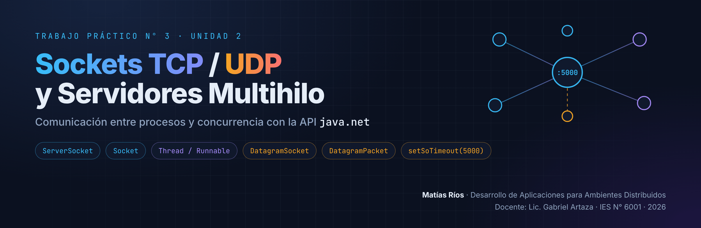
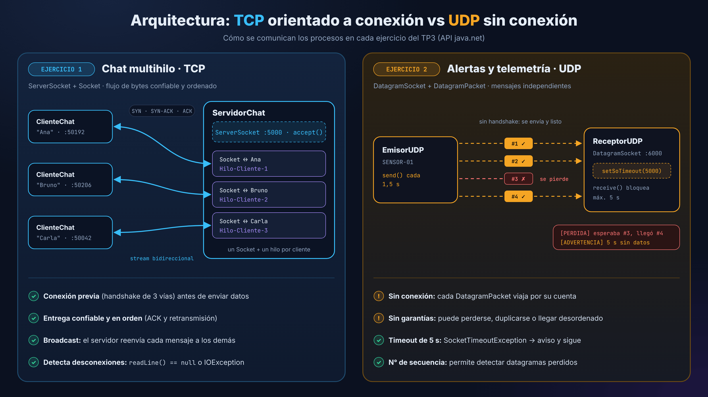
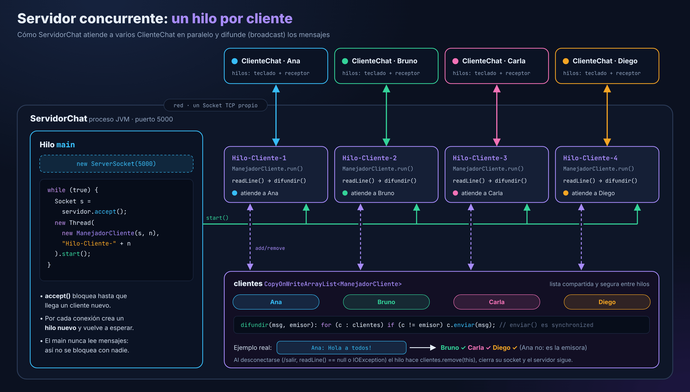
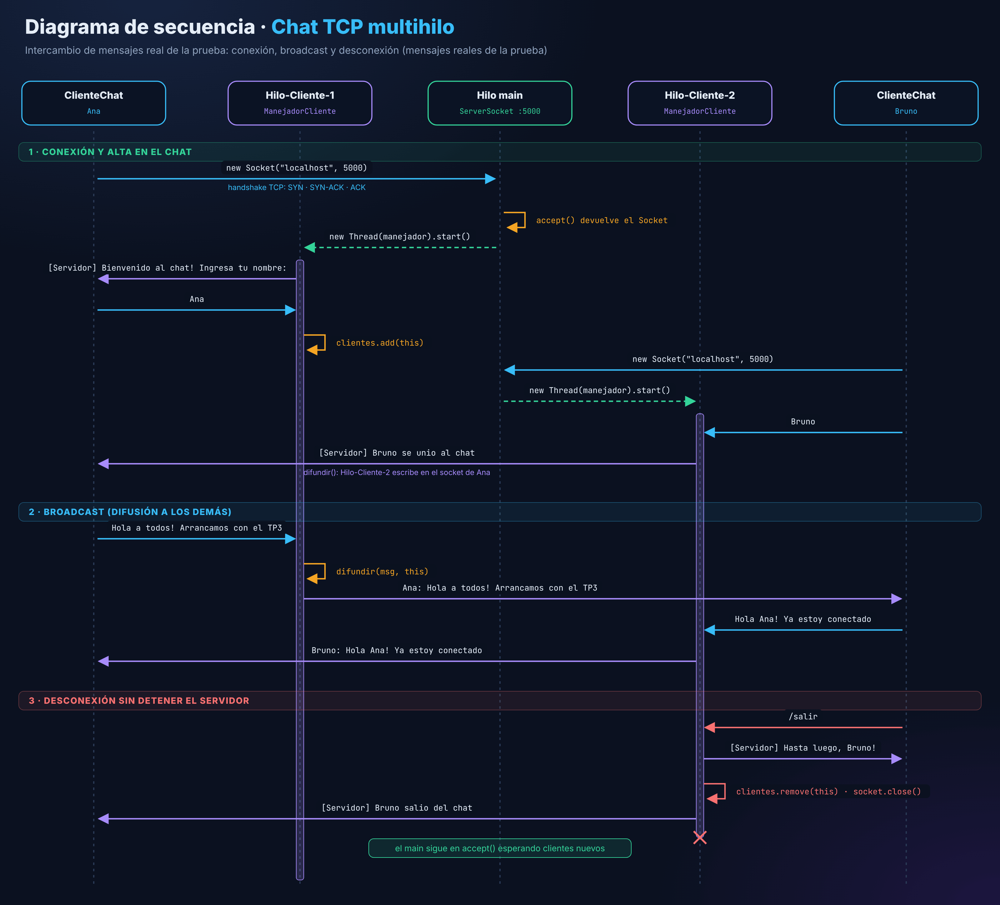
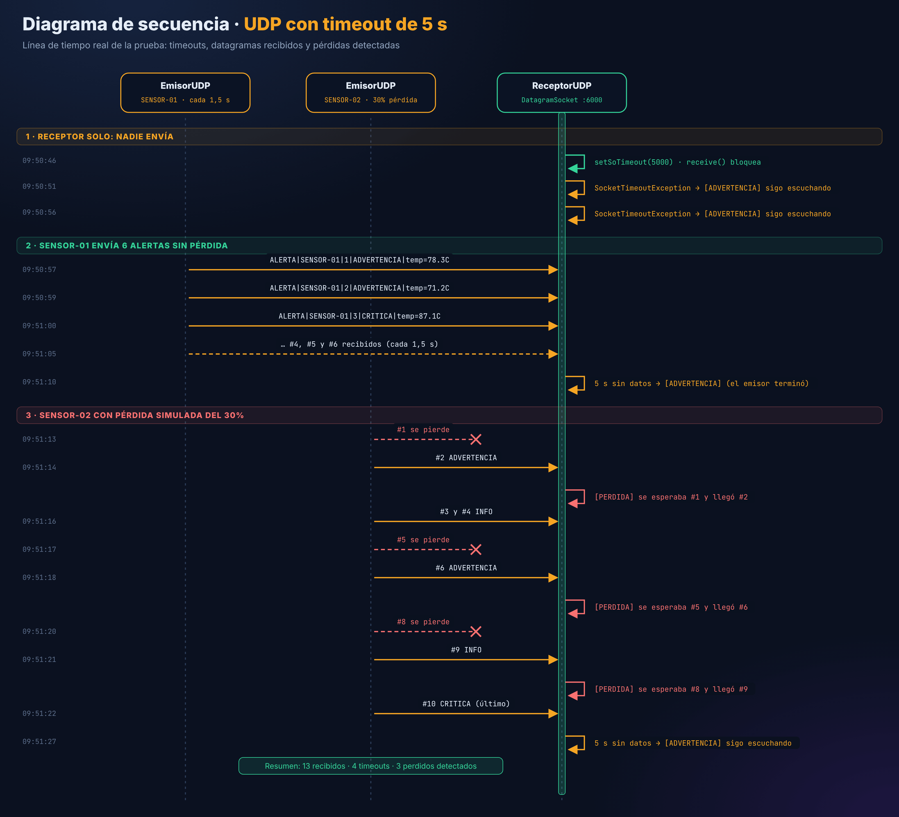
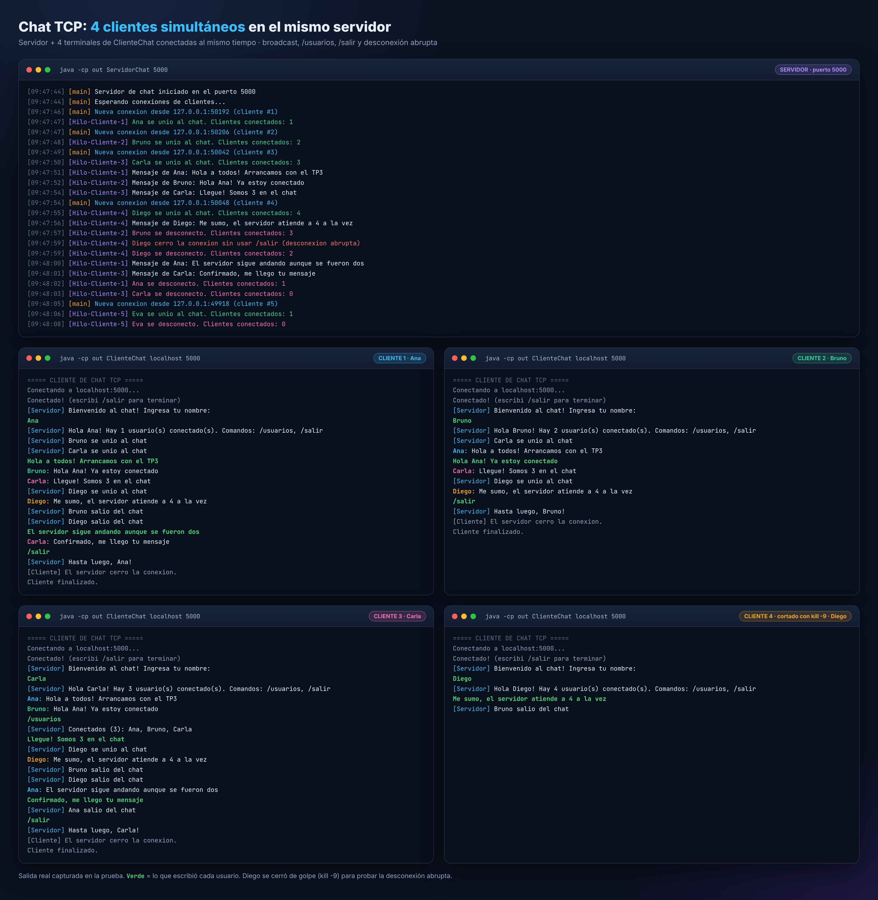
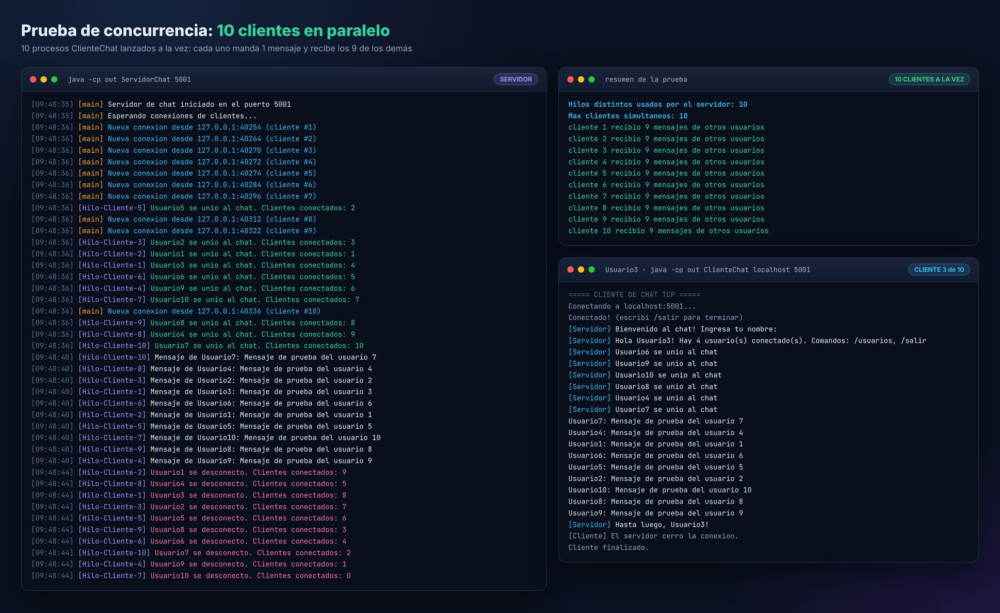
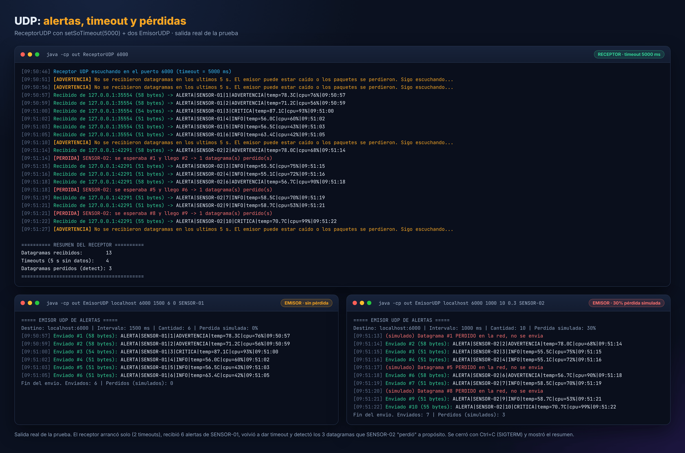
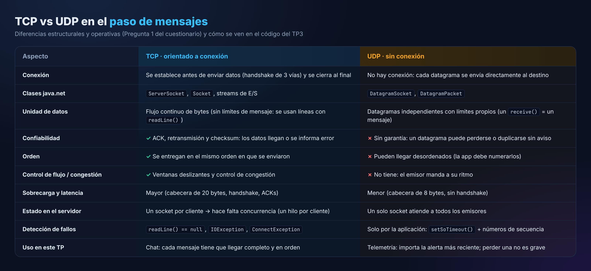

<p align="center">
  
</p>

# TP N° 3: Sockets TCP/UDP con API java.net y Servidores Multihilo

| | |
|---|---|
| **Asignatura** | Desarrollo de Aplicaciones para Ambientes Distribuidos |
| **Unidad** | 2: Comunicación entre Procesos y Concurrencia |
| **Docente** | Lic. Gabriel Artaza |
| **Alumno** | Matías Ríos |
| **Institución** | IES N° 6001 · Salta · 2026 |
| **Lenguaje** | Java (solo API estándar `java.net`, sin librerías externas) |

## Índice

1. [Objetivo](#1-objetivo)
2. [Estructura del proyecto](#2-estructura-del-proyecto)
3. [Cómo compilar y ejecutar (Windows)](#3-cómo-compilar-y-ejecutar-windows)
4. [Arquitectura general](#4-arquitectura-general)
5. [Ejercicio 1: Servidor de Chat Multihilo (TCP)](#5-ejercicio-1-servidor-de-chat-multihilo-tcp)
6. [Ejercicio 2: Receptor de Alertas y Telemetría (UDP)](#6-ejercicio-2-receptor-de-alertas-y-telemetría-udp)
7. [Pruebas y capturas (salidas reales)](#7-pruebas-y-capturas-salidas-reales)
8. [Cuestionario teórico](#8-cuestionario-teórico)
9. [Conclusiones](#9-conclusiones)

---

## 1. Objetivo

Aplicar el **paso de mensajes a nivel de la capa de transporte** usando la API `java.net`:

- **Ejercicio 1 (TCP):** un servidor de chat **concurrente** que atiende a varios clientes en paralelo (un hilo por cliente), **difunde** cada mensaje a los demás conectados y **maneja las desconexiones** sin detenerse.
- **Ejercicio 2 (UDP):** un emisor que manda **alertas de telemetría** a intervalos regulares y un receptor con **timeout de 5 segundos** (`setSoTimeout(5000)`) que avisa cuando no llegan datagramas y sigue escuchando.
- Responder el **cuestionario teórico** y documentar todo en este README.

---

## 2. Estructura del proyecto

```
T.P3/
├── README.md                      ← este documento
├── .gitignore                     ← evita subir los .class
├── img/                           ← diagramas y capturas del README
│   ├── banner.png
│   ├── arquitectura_tcp_vs_udp.png
│   ├── comparativa_tcp_udp.png
│   ├── servidor_multihilo.png
│   ├── secuencia_chat_tcp.png
│   ├── secuencia_udp_timeout.png
│   ├── terminal_chat_tcp.png
│   ├── terminal_estres.png
│   └── terminal_udp.png
└── src/
    ├── ejercicio1_tcp/
    │   ├── ServidorChat.java      ← ServerSocket + un hilo (Runnable) por cliente + broadcast
    │   └── ClienteChat.java       ← Socket + hilo receptor para ver los mensajes en tiempo real
    └── ejercicio2_udp/
        ├── EmisorUDP.java         ← DatagramSocket que envía alertas cada N ms
        └── ReceptorUDP.java       ← DatagramSocket con setSoTimeout(5000) y detección de pérdidas
```

| Archivo | Clases de `java.net` que usa | Qué hace |
|---|---|---|
| `ServidorChat.java` | `ServerSocket`, `Socket` | Escucha en el puerto **5000**, acepta conexiones y crea un `Thread` con un `ManejadorCliente` (Runnable) por cada cliente. |
| `ClienteChat.java` | `Socket` | Se conecta al servidor. Un hilo lee el teclado y otro muestra lo que llega del servidor. |
| `EmisorUDP.java` | `DatagramSocket`, `DatagramPacket`, `InetAddress` | Envía una alerta numerada cada cierto intervalo. Puede simular pérdida de paquetes. |
| `ReceptorUDP.java` | `DatagramSocket`, `DatagramPacket`, `SocketTimeoutException` | Recibe alertas en el puerto **6000**. Si pasan 5 s sin datos, avisa y sigue escuchando. |

---

## 3. Cómo compilar y ejecutar (Windows)

**Requisito:** tener instalado un JDK 8 o superior (`javac -version` en la consola). Se probó con JDK 21.

Abrí una consola (CMD o PowerShell) **parada en la carpeta `T.P3`**:

```bat
cd T.P3
```

### 3.1 Compilar

Los `.class` se generan en la carpeta `out\`, que **no se sube** al repo (está en el `.gitignore`).

```bat
javac -encoding UTF-8 -d out src\ejercicio1_tcp\*.java src\ejercicio2_udp\*.java
```

### 3.2 Ejercicio 1: Chat TCP (1 servidor + 3 o más clientes)

**Terminal 1: servidor** (puerto 5000 por defecto, o el que pases como argumento):

```bat
java -cp out ServidorChat
```

> La primera vez Windows puede mostrar un aviso del Firewall para Java: hay que tocar **Permitir acceso**.

**Terminales 2, 3 y 4: clientes.** Desde **CMD** podés abrir cada uno en una ventana nueva con `start` (o abrir tres consolas a mano y ejecutar `java -cp out ClienteChat` en cada una):

```bat
start "Cliente 1" cmd /k java -cp out ClienteChat
start "Cliente 2" cmd /k java -cp out ClienteChat
start "Cliente 3" cmd /k java -cp out ClienteChat
```

Cada cliente pide un nombre y después todo lo que escribas les llega a los demás. Comandos disponibles:

| Comando | Qué hace |
|---|---|
| *(cualquier texto)* | Se envía a **todos los demás** clientes conectados (broadcast). |
| `/usuarios` | Muestra la lista de usuarios conectados. |
| `/salir` | Se desconecta prolijamente. El servidor sigue funcionando. |

Para conectarse desde otra PC de la red: `java -cp out ClienteChat 192.168.x.x 5000`.

### 3.3 Ejercicio 2: Alertas UDP

**Terminal 1: receptor** (puerto 6000 por defecto):

```bat
java -cp out ReceptorUDP
```

Si no arrancás ningún emisor, cada 5 segundos vas a ver la advertencia de timeout.

**Terminal 2: emisor.** Los argumentos son opcionales: `[host] [puerto] [intervaloMs] [cantidad] [probPerdida] [idSensor]`.

```bat
java -cp out EmisorUDP
```

Así manda una alerta cada 2 s sin parar (se corta con Ctrl+C). Otros ejemplos:

| Comando | Qué hace |
|---|---|
| `java -cp out EmisorUDP localhost 6000 1500 6 0 SENSOR-01` | 6 alertas cada 1,5 s, sin pérdida. |
| `java -cp out EmisorUDP localhost 6000 1000 10 0.3 SENSOR-02` | 10 alertas cada 1 s, simulando que se pierde el 30 % de los datagramas. |

Para terminar el receptor apretá **Ctrl+C**: muestra un resumen con lo recibido, los timeouts y las pérdidas detectadas.

---

## 4. Arquitectura general

<p align="center"></p>

- En **TCP** primero se establece una **conexión** (handshake) y después cada cliente tiene un **canal propio** (`Socket`) con el servidor, confiable y ordenado. Como cada canal se atiende con lecturas bloqueantes, el servidor necesita **un hilo por cliente**.
- En **UDP** no hay conexión: el emisor arma un `DatagramPacket` con la dirección del destino y lo manda. Un **único** `DatagramSocket` en el receptor recibe los datagramas de cualquier emisor, pero **nada garantiza** que lleguen. Por eso el receptor usa un **timeout** y **números de secuencia**.

---

## 5. Ejercicio 1: Servidor de Chat Multihilo (TCP)

<p align="center"></p>

### 5.1 Servidor concurrente (`ServidorChat`)

El hilo `main` **solo acepta conexiones**. Cada vez que `accept()` devuelve un `Socket`, la atención de ese cliente se **delega a un hilo independiente** (`Thread` + `Runnable`) y el `main` vuelve enseguida a esperar al próximo:

```java
try (ServerSocket servidor = new ServerSocket(puerto)) {
    while (true) {
        // accept() bloquea hasta que llega un cliente nuevo
        Socket socket = servidor.accept();
        int numero = contadorClientes.incrementAndGet();

        // Se delega la atencion del cliente a un hilo independiente
        ManejadorCliente manejador = new ManejadorCliente(socket, numero);
        Thread hilo = new Thread(manejador, "Hilo-Cliente-" + numero);
        hilo.start();
    }
}
```

Cada `ManejadorCliente` (clase interna que implementa `Runnable`) hace lo siguiente en su propio hilo:

1. Pide el nombre de usuario.
2. Se agrega a la lista compartida `clientes`.
3. Entra en un bucle `readLine()` hasta que el cliente se va.

En el log del servidor se ve qué hilo hace cada cosa: `[main]` acepta y `[Hilo-Cliente-N]` atiende.

### 5.2 Difusión de mensajes (broadcast)

Todos los manejadores están en una **lista compartida** entre hilos. Se eligió `CopyOnWriteArrayList` porque permite recorrerla mientras otro hilo agrega o quita un cliente, sin `ConcurrentModificationException`. Cuando llega un mensaje, se reenvía a todos **menos al que lo mandó**:

```java
private static final List<ManejadorCliente> clientes = new CopyOnWriteArrayList<>();

static void difundir(String mensaje, ManejadorCliente emisor) {
    for (ManejadorCliente cliente : clientes) {
        if (cliente != emisor) {
            cliente.enviar(mensaje);
        }
    }
}

/** synchronized: varios hilos pueden escribirle al mismo cliente a la vez */
synchronized void enviar(String mensaje) {
    if (salida != null) {
        salida.println(mensaje);
    }
}
```

`enviar()` es `synchronized` porque **varios hilos pueden escribir en el mismo socket al mismo tiempo**, por ejemplo si Ana y Bruno hablan a la vez, los dos hilos le escriben a Carla. Así las líneas no se mezclan.

<p align="center"></p>

### 5.3 Manejo de desconexiones

El servidor contempla los tres casos posibles y en todos hace lo mismo: saca al cliente de la lista, **cierra su socket**, avisa a los demás y **sigue atendiendo** a los otros clientes y a los nuevos.

| Caso | Cómo se detecta |
|---|---|
| El usuario escribe `/salir` | Se lee el comando, se despide y se sale del bucle. |
| Se cierra el programa cliente o la ventana | `readLine()` devuelve `null` (el otro extremo cerró la conexión). Se registra como **desconexión abrupta**. |
| Se corta la red o la conexión se resetea | `readLine()` lanza `IOException` y se registra *"Conexion perdida"*. |

```java
} catch (IOException e) {
    // Desconexion abrupta (se cerro la ventana, se corto la red, etc.)
    log("Conexion perdida con " + nombre + " (" + e.getMessage() + ")");
} finally {
    desconectar();   // clientes.remove(this) + socket.close() + aviso a los demas
}
```

Como cada cliente tiene **su propio hilo** y el `try/catch/finally` está dentro de ese hilo, un error con un cliente **nunca** afecta al hilo `main` ni a los otros clientes.

### 5.4 Cliente (`ClienteChat`)

Un chat tiene que mostrar los mensajes **mientras el usuario está escribiendo**, así que el cliente también usa dos hilos:

- **Hilo `Receptor`** (daemon): hace `readLine()` sobre el socket y muestra todo lo que llega del servidor en tiempo real.
- **Hilo `main`:** lee el teclado con `Scanner` y envía cada línea al servidor.

Si el servidor no está levantado, el cliente lo informa con `ConnectException`, por ejemplo *"No se pudo conectar al servidor: Connection refused"*.

---

## 6. Ejercicio 2: Receptor de Alertas y Telemetría (UDP)

### 6.1 Emisor UDP (`EmisorUDP`)

Envía una alerta en un **intervalo regular**, cada 2 s por defecto. No hay conexión: se crea un `DatagramSocket` y cada mensaje viaja en su propio `DatagramPacket` con la dirección y el puerto de destino:

```java
try (DatagramSocket socket = new DatagramSocket()) {
    InetAddress direccion = InetAddress.getByName(host);
    ...
    byte[] datos = mensaje.getBytes(StandardCharsets.UTF_8);
    DatagramPacket paquete = new DatagramPacket(datos, datos.length, direccion, puerto);
    socket.send(paquete);
    ...
    Thread.sleep(intervalo);
}
```

Cada alerta lleva telemetría simulada (temperatura y CPU), un nivel calculado (`INFO`, `ADVERTENCIA` o `CRITICA`) y un **número de secuencia**:

```
ALERTA|SENSOR-01|3|CRITICA|temp=87.1C|cpu=93%|09:51:00
  │       │      │    │        └── telemetria          └── hora de envio
  │       │      │    └── nivel de la alerta
  │       │      └── numero de secuencia (1, 2, 3, ...)
  │       └── id del sensor
  └── tipo de mensaje
```

Con el parámetro `probPerdida` el emisor puede **simular pérdida de paquetes**: no envía algunos datagramas a propósito. Sirve para probar que el receptor detecta los huecos.

### 6.2 Receptor UDP con timeout (`ReceptorUDP`)

Este es el núcleo de la consigna. `receive()` es bloqueante, pero con `setSoTimeout(5000)` espera **como máximo 5 segundos**. Si no llega nada, lanza `SocketTimeoutException`. El receptor la captura, **registra una advertencia y vuelve a escuchar**, sin cortar el programa:

```java
try (DatagramSocket socket = new DatagramSocket(puerto)) {

    socket.setSoTimeout(5000);          // tiempo limite de espera para receive()
    byte[] buffer = new byte[1024];

    while (true) {
        DatagramPacket paquete = new DatagramPacket(buffer, buffer.length);
        try {
            socket.receive(paquete);    // bloquea hasta 5 s
            String mensaje = new String(paquete.getData(), 0, paquete.getLength(),
                    StandardCharsets.UTF_8);
            log("Recibido de " + paquete.getAddress().getHostAddress() + ... );
            verificarSecuencia(mensaje);

        } catch (SocketTimeoutException e) {
            timeouts++;
            log("[ADVERTENCIA] No se recibieron datagramas en los ultimos 5 s. ... Sigo escuchando...");
        }
    }
}
```

Además del timeout pedido, el receptor compara el **número de secuencia** de cada alerta con el último recibido de ese sensor. Si hay un hueco, informa cuántos datagramas se perdieron:

```java
Integer anterior = ultimaSecuencia.getOrDefault(sensor, 0);
if (secuencia > anterior + 1) {
    int perdidos = secuencia - anterior - 1;
    log("[PERDIDA] " + sensor + ": se esperaba #" + (anterior + 1) + " y llego #" + secuencia ...);
}
```

Al cerrarlo con **Ctrl+C**, un *shutdown hook* imprime un resumen: datagramas recibidos, timeouts y pérdidas detectadas.

<p align="center"></p>

---

## 7. Pruebas y capturas (salidas reales)

Todas las salidas de esta sección son **reales**: se copiaron tal cual de ejecuciones de los programas compilados. Las capturas tipo terminal se generaron a partir de esas mismas salidas.

### 7.1 Chat TCP con 4 clientes conectados simultáneamente

Escenario de la prueba:

1. Se conectan **Ana, Bruno y Carla** y chatean entre ellos. Carla prueba `/usuarios`.
2. Se suma **Diego**, y quedan **4 clientes a la vez**.
3. Bruno sale con `/salir`, y a Diego se le **mata el proceso de golpe** (`kill -9`) para simular que cerró la ventana.
4. Ana y Carla siguen chateando: **el servidor no se cae**. Después salen las dos.
5. Se conecta **Eva** con el servidor ya vacío, para comprobar que sigue aceptando clientes.

<p align="center"></p>

**Log real del servidor.** Se ve que `[main]` solo acepta conexiones y que cada cliente es atendido por su propio `[Hilo-Cliente-N]`:

```text
[09:47:44] [main] Servidor de chat iniciado en el puerto 5000
[09:47:44] [main] Esperando conexiones de clientes...
[09:47:46] [main] Nueva conexion desde 127.0.0.1:50192 (cliente #1)
[09:47:47] [Hilo-Cliente-1] Ana se unio al chat. Clientes conectados: 1
[09:47:47] [main] Nueva conexion desde 127.0.0.1:50206 (cliente #2)
[09:47:48] [Hilo-Cliente-2] Bruno se unio al chat. Clientes conectados: 2
[09:47:49] [main] Nueva conexion desde 127.0.0.1:50042 (cliente #3)
[09:47:50] [Hilo-Cliente-3] Carla se unio al chat. Clientes conectados: 3
[09:47:51] [Hilo-Cliente-1] Mensaje de Ana: Hola a todos! Arrancamos con el TP3
[09:47:52] [Hilo-Cliente-2] Mensaje de Bruno: Hola Ana! Ya estoy conectado
[09:47:54] [Hilo-Cliente-3] Mensaje de Carla: Llegue! Somos 3 en el chat
[09:47:54] [main] Nueva conexion desde 127.0.0.1:50048 (cliente #4)
[09:47:55] [Hilo-Cliente-4] Diego se unio al chat. Clientes conectados: 4
[09:47:56] [Hilo-Cliente-4] Mensaje de Diego: Me sumo, el servidor atiende a 4 a la vez
[09:47:57] [Hilo-Cliente-2] Bruno se desconecto. Clientes conectados: 3
[09:47:59] [Hilo-Cliente-4] Diego cerro la conexion sin usar /salir (desconexion abrupta)
[09:47:59] [Hilo-Cliente-4] Diego se desconecto. Clientes conectados: 2
[09:48:00] [Hilo-Cliente-1] Mensaje de Ana: El servidor sigue andando aunque se fueron dos
[09:48:01] [Hilo-Cliente-3] Mensaje de Carla: Confirmado, me llego tu mensaje
[09:48:02] [Hilo-Cliente-1] Ana se desconecto. Clientes conectados: 1
[09:48:03] [Hilo-Cliente-3] Carla se desconecto. Clientes conectados: 0
[09:48:05] [main] Nueva conexion desde 127.0.0.1:49918 (cliente #5)
[09:48:06] [Hilo-Cliente-5] Eva se unio al chat. Clientes conectados: 1
[09:48:08] [Hilo-Cliente-5] Eva se desconecto. Clientes conectados: 0
```

**Salida real del cliente Carla** (los mensajes de los demás le llegan en tiempo real):

```text
===== CLIENTE DE CHAT TCP =====
Conectando a localhost:5000...
Conectado! (escribi /salir para terminar)
[Servidor] Bienvenido al chat! Ingresa tu nombre:
Carla
[Servidor] Hola Carla! Hay 3 usuario(s) conectado(s). Comandos: /usuarios, /salir
Ana: Hola a todos! Arrancamos con el TP3
Bruno: Hola Ana! Ya estoy conectado
/usuarios
[Servidor] Conectados (3): Ana, Bruno, Carla
Llegue! Somos 3 en el chat
[Servidor] Diego se unio al chat
Diego: Me sumo, el servidor atiende a 4 a la vez
[Servidor] Bruno salio del chat
[Servidor] Diego salio del chat
Ana: El servidor sigue andando aunque se fueron dos
Confirmado, me llego tu mensaje
[Servidor] Ana salio del chat
/salir
[Servidor] Hasta luego, Carla!
[Cliente] El servidor cerro la conexion.
Cliente finalizado.
```

### 7.2 Prueba de concurrencia: 10 clientes en paralelo

Se lanzaron **10 procesos `ClienteChat` al mismo tiempo** contra el servidor. Cada uno mandó 1 mensaje y debía recibir los 9 mensajes de los demás.

<p align="center"></p>

Resultado real:

```text
Hilos distintos usados por el servidor: 10
Max clientes simultaneos: 10
cliente 1 recibio 9 mensajes de otros usuarios
cliente 2 recibio 9 mensajes de otros usuarios
cliente 3 recibio 9 mensajes de otros usuarios
cliente 4 recibio 9 mensajes de otros usuarios
cliente 5 recibio 9 mensajes de otros usuarios
cliente 6 recibio 9 mensajes de otros usuarios
cliente 7 recibio 9 mensajes de otros usuarios
cliente 8 recibio 9 mensajes de otros usuarios
cliente 9 recibio 9 mensajes de otros usuarios
cliente 10 recibio 9 mensajes de otros usuarios
```

Un detalle interesante del log: los hilos no atienden en orden. Por ejemplo, `Hilo-Cliente-3` registró a `Usuario2` y `Hilo-Cliente-1` a `Usuario3`. Es la prueba de que los clientes se atienden **en paralelo**, cada uno a su ritmo, y no en fila.

### 7.3 UDP: timeout, alertas y pérdidas

Escenario de la prueba:

1. El receptor arranca solo: como nadie envía, salta el **timeout cada 5 s** y sigue escuchando.
2. `SENSOR-01` envía 6 alertas sin pérdida.
3. Pasan 5 s sin datos y aparece otro timeout.
4. `SENSOR-02` envía 10 alertas con **30 % de pérdida simulada**, y el receptor detecta cada hueco.
5. Se cierra el receptor con Ctrl+C y se imprime el resumen.

<p align="center"></p>

**Log real del receptor:**

```text
[09:50:46] Receptor UDP escuchando en el puerto 6000 (timeout = 5000 ms)
[09:50:51] [ADVERTENCIA] No se recibieron datagramas en los ultimos 5 s. El emisor puede estar caido o los paquetes se perdieron. Sigo escuchando...
[09:50:56] [ADVERTENCIA] No se recibieron datagramas en los ultimos 5 s. El emisor puede estar caido o los paquetes se perdieron. Sigo escuchando...
[09:50:57] Recibido de 127.0.0.1:35554 (58 bytes) -> ALERTA|SENSOR-01|1|ADVERTENCIA|temp=78.3C|cpu=76%|09:50:57
[09:50:59] Recibido de 127.0.0.1:35554 (58 bytes) -> ALERTA|SENSOR-01|2|ADVERTENCIA|temp=71.2C|cpu=56%|09:50:59
[09:51:00] Recibido de 127.0.0.1:35554 (54 bytes) -> ALERTA|SENSOR-01|3|CRITICA|temp=87.1C|cpu=93%|09:51:00
[09:51:02] Recibido de 127.0.0.1:35554 (51 bytes) -> ALERTA|SENSOR-01|4|INFO|temp=56.0C|cpu=60%|09:51:02
[09:51:03] Recibido de 127.0.0.1:35554 (51 bytes) -> ALERTA|SENSOR-01|5|INFO|temp=56.5C|cpu=43%|09:51:03
[09:51:05] Recibido de 127.0.0.1:35554 (51 bytes) -> ALERTA|SENSOR-01|6|INFO|temp=63.4C|cpu=42%|09:51:05
[09:51:10] [ADVERTENCIA] No se recibieron datagramas en los ultimos 5 s. El emisor puede estar caido o los paquetes se perdieron. Sigo escuchando...
[09:51:14] Recibido de 127.0.0.1:42291 (58 bytes) -> ALERTA|SENSOR-02|2|ADVERTENCIA|temp=78.0C|cpu=68%|09:51:14
[09:51:14] [PERDIDA] SENSOR-02: se esperaba #1 y llego #2 -> 1 datagrama(s) perdido(s)
[09:51:15] Recibido de 127.0.0.1:42291 (51 bytes) -> ALERTA|SENSOR-02|3|INFO|temp=55.5C|cpu=75%|09:51:15
[09:51:16] Recibido de 127.0.0.1:42291 (51 bytes) -> ALERTA|SENSOR-02|4|INFO|temp=55.1C|cpu=72%|09:51:16
[09:51:18] Recibido de 127.0.0.1:42291 (58 bytes) -> ALERTA|SENSOR-02|6|ADVERTENCIA|temp=56.7C|cpu=90%|09:51:18
[09:51:18] [PERDIDA] SENSOR-02: se esperaba #5 y llego #6 -> 1 datagrama(s) perdido(s)
[09:51:19] Recibido de 127.0.0.1:42291 (51 bytes) -> ALERTA|SENSOR-02|7|INFO|temp=58.5C|cpu=70%|09:51:19
[09:51:21] Recibido de 127.0.0.1:42291 (51 bytes) -> ALERTA|SENSOR-02|9|INFO|temp=58.7C|cpu=53%|09:51:21
[09:51:21] [PERDIDA] SENSOR-02: se esperaba #8 y llego #9 -> 1 datagrama(s) perdido(s)
[09:51:22] Recibido de 127.0.0.1:42291 (55 bytes) -> ALERTA|SENSOR-02|10|CRITICA|temp=70.7C|cpu=99%|09:51:22
[09:51:27] [ADVERTENCIA] No se recibieron datagramas en los ultimos 5 s. El emisor puede estar caido o los paquetes se perdieron. Sigo escuchando...

========== RESUMEN DEL RECEPTOR ==========
Datagramas recibidos:        13
Timeouts (5 s sin datos):    4
Datagramas perdidos (detect): 3
==========================================
```

**Salida real del emisor con pérdida simulada.** Los 3 datagramas que "se perdieron" (#1, #5 y #8) son exactamente los 3 que detectó el receptor:

```text
===== EMISOR UDP DE ALERTAS =====
Destino: localhost:6000 | Intervalo: 1000 ms | Cantidad: 10 | Perdida simulada: 30%
[09:51:13] (simulado) Datagrama #1 PERDIDO en la red, no se envia
[09:51:14] Enviado #2 (58 bytes): ALERTA|SENSOR-02|2|ADVERTENCIA|temp=78.0C|cpu=68%|09:51:14
[09:51:15] Enviado #3 (51 bytes): ALERTA|SENSOR-02|3|INFO|temp=55.5C|cpu=75%|09:51:15
[09:51:16] Enviado #4 (51 bytes): ALERTA|SENSOR-02|4|INFO|temp=55.1C|cpu=72%|09:51:16
[09:51:17] (simulado) Datagrama #5 PERDIDO en la red, no se envia
[09:51:18] Enviado #6 (58 bytes): ALERTA|SENSOR-02|6|ADVERTENCIA|temp=56.7C|cpu=90%|09:51:18
[09:51:19] Enviado #7 (51 bytes): ALERTA|SENSOR-02|7|INFO|temp=58.5C|cpu=70%|09:51:19
[09:51:20] (simulado) Datagrama #8 PERDIDO en la red, no se envia
[09:51:21] Enviado #9 (51 bytes): ALERTA|SENSOR-02|9|INFO|temp=58.7C|cpu=53%|09:51:21
[09:51:22] Enviado #10 (55 bytes): ALERTA|SENSOR-02|10|CRITICA|temp=70.7C|cpu=99%|09:51:22
Fin del envio. Enviados: 7 | Perdidos (simulados): 3
```

### 7.4 TCP vs UDP cuando no hay nadie del otro lado

Esta prueba muestra en la práctica la diferencia entre "con conexión" y "sin conexión":

**Cliente TCP sin servidor.** Falla enseguida, porque no se puede establecer la conexión:

```text
===== CLIENTE DE CHAT TCP =====
Conectando a localhost:5999...
No se pudo conectar al servidor: Connection refused
Cliente finalizado.
```

**Emisor UDP sin receptor.** "Envía" sin ningún error, porque UDP no verifica que alguien esté escuchando. Los datagramas simplemente se pierden:

```text
===== EMISOR UDP DE ALERTAS =====
Destino: localhost:6001 | Intervalo: 500 ms | Cantidad: 3 | Perdida simulada: 0%
[09:51:36] Enviado #1 (51 bytes): ALERTA|SENSOR-99|1|INFO|temp=69.3C|cpu=69%|09:51:36
[09:51:37] Enviado #2 (54 bytes): ALERTA|SENSOR-99|2|CRITICA|temp=80.4C|cpu=49%|09:51:37
[09:51:37] Enviado #3 (58 bytes): ALERTA|SENSOR-99|3|ADVERTENCIA|temp=66.9C|cpu=79%|09:51:37
Fin del envio. Enviados: 3 | Perdidos (simulados): 0
```

---

## 8. Cuestionario teórico

### 8.1 Capa de Transporte: diferencias entre TCP (orientado a conexión) y UDP (sin conexión)

<p align="center"></p>

**Diferencias estructurales:**

- **TCP** establece una **conexión lógica** entre dos procesos antes de intercambiar datos (*three-way handshake*: SYN, SYN-ACK, ACK). Cada extremo mantiene estado: números de secuencia, ventana y buffers. En Java eso se ve en que el servidor necesita un `ServerSocket` para escuchar y obtiene **un `Socket` distinto por cada cliente**. Los datos viajan como un **flujo continuo de bytes** (stream), sin límites de mensaje: por eso en el chat cada mensaje es una línea y se lee con `readLine()`.
- **UDP** **no establece conexión ni guarda estado**. Cada `DatagramPacket` es una unidad independiente que lleva su propia dirección y puerto de destino. Un **solo `DatagramSocket`** puede recibir datagramas de muchos emisores, y cada `receive()` entrega exactamente un mensaje completo, con sus límites conservados.

**Diferencias operativas:**

- **Confiabilidad:** TCP confirma cada segmento con ACK y retransmite lo que se pierde, así que los datos llegan completos, **sin duplicados y en orden**, o la aplicación recibe un error (`IOException`). UDP no confirma ni retransmite: un datagrama puede **perderse, duplicarse o llegar desordenado** sin que nadie se entere.
- **Control de flujo y congestión:** TCP adapta la velocidad al receptor y al estado de la red. UDP manda al ritmo que quiera el emisor.
- **Costo:** TCP tiene más sobrecarga (cabecera de 20 bytes, handshake y ACKs) y más latencia. UDP es más liviano (cabecera de 8 bytes) y rápido.
- **Responsabilidad de la aplicación:** con TCP la aplicación se despreocupa de pérdidas y orden. Con UDP, si le importan, **los tiene que resolver ella**: en este TP con `setSoTimeout()` y números de secuencia.

**En el paso de mensajes**, TCP conviene cuando cada mensaje importa y el orden también, como en un chat, una transferencia o una transacción. UDP conviene cuando importa más la velocidad y el dato más reciente que recuperar uno viejo, como en telemetría, streaming, juegos en línea o DNS. La prueba 7.4 lo muestra: el cliente TCP sin servidor falla al instante (`Connection refused`), mientras que el emisor UDP "envía" sin error aunque no haya nadie escuchando.

### 8.2 API java.net: función de `ServerSocket.accept()` y por qué un hilo por cliente

**Función de `accept()`:** el `ServerSocket` queda escuchando en un puerto, el 5000 en este TP. El sistema operativo completa el handshake con los clientes que se conectan y los deja en una **cola de conexiones pendientes** (*backlog*). `accept()` **bloquea** al hilo que lo llama hasta que hay una conexión en esa cola, la saca y devuelve un **nuevo objeto `Socket`** conectado exclusivamente a ese cliente. El `ServerSocket` original **no se usa para conversar**: solo sigue escuchando para recibir más conexiones. Por eso hay *un* `ServerSocket` y *N* `Socket`, uno por cliente.

**Por qué es indispensable un hilo dedicado por cliente:** en la API de `java.net` las operaciones de E/S son **bloqueantes**. `accept()` bloquea hasta que llega un cliente y `readLine()` bloquea hasta que ese cliente manda una línea. Si un solo hilo hiciera todo:

- Mientras espera el mensaje de un cliente con `readLine()`, **no puede aceptar a nadie más** ni leer lo que escriben los otros. Los demás quedarían congelados en la cola.
- El servidor atendería **de a un cliente por vez**. Eso contradice la idea de un chat, donde todos hablan a la vez y los mensajes tienen que difundirse en tiempo real.
- Un cliente lento o colgado **bloquearía a todo el servidor**.

Con un hilo por cliente, cada `readLine()` bloquea **solo a su propio hilo**. El hilo `main` vuelve de inmediato a `accept()`, los clientes se atienden **en paralelo** y si uno falla, su excepción queda aislada en su hilo. La prueba 7.2 lo confirma: 10 clientes simultáneos atendidos por 10 hilos distintos, y cada uno recibió los 9 mensajes de los demás.

> **Mejora posible:** con muchísimos clientes, crear un hilo por conexión consume memoria. En producción se suele usar un **pool de hilos** (`ExecutorService`) para limitar la cantidad, o E/S no bloqueante (`java.nio` con `Selector`). Para este TP se usó `Thread` + `Runnable`, como pide la consigna.

### 8.3 Manejo de errores y resiliencia: pérdida de un paquete UDP y `setSoTimeout()`

**¿Qué pasa si el datagrama se pierde?** UDP no tiene confirmaciones ni retransmisiones, así que **nadie se entera en la capa de transporte**:

- El **emisor** no recibe ningún error: `send()` termina normalmente apenas el datagrama sale de la placa de red. Lo comprobamos en la prueba 7.4, donde el emisor "envió" 3 alertas sin que hubiera ningún receptor.
- El **receptor** simplemente **nunca recibe** ese datagrama. No hay aviso ni excepción por el paquete perdido: el dato se pierde para siempre, salvo que la aplicación implemente su propio mecanismo de recuperación (ACK y reenvío).

**¿Cómo lo detecta el receptor con `setSoTimeout()`?** Sin timeout, `receive()` se quedaría bloqueado **para siempre** esperando un datagrama que nunca va a llegar, y el programa no podría reaccionar. Con `socket.setSoTimeout(5000)`, `receive()` espera **como máximo 5 segundos**. Si en ese lapso no llegó nada, lanza `SocketTimeoutException`. El receptor la captura, **registra la advertencia y vuelve a llamar a `receive()`**, sin caerse:

```text
[09:51:27] [ADVERTENCIA] No se recibieron datagramas en los ultimos 5 s. El emisor puede estar caido o los paquetes se perdieron. Sigo escuchando...
```

Hay que aclarar el alcance: el timeout detecta la **ausencia de datos** durante un tiempo, pero no puede distinguir si el emisor se cayó, si la red está cortada o si los paquetes se perdieron, ni *cuál* paquete faltó. Por eso en este TP se combinó con **números de secuencia**:

- Si se pierde un datagrama **en el medio**, el receptor lo detecta cuando llega el siguiente, por el hueco en la secuencia: `[PERDIDA] SENSOR-02: se esperaba #5 y llego #6`.
- Si se pierden **los últimos** o se cae el emisor, no hay "siguiente" que delate el hueco. En ese caso el que avisa es el **timeout**.

En la prueba 7.3, el emisor perdió a propósito los datagramas #1, #5 y #8. El receptor detectó **los 3** por secuencia y además registró los timeouts cuando no había emisores activos.

---

## 9. Conclusiones

- La API `java.net` permite implementar paso de mensajes a nivel de transporte con muy poco código: `ServerSocket`/`Socket` para TCP y `DatagramSocket`/`DatagramPacket` para UDP.
- En TCP, como la E/S es bloqueante, **la concurrencia es obligatoria** para atender a varios clientes: el hilo `main` acepta y cada cliente tiene su hilo. Con eso el chat funcionó con 4 clientes interactivos y con 10 clientes simultáneos sin perder ningún mensaje.
- Compartir datos entre hilos exige cuidado: se usó `CopyOnWriteArrayList` para la lista de clientes, `AtomicInteger` para el contador y `synchronized` en `enviar()` para que no se mezclen las escrituras.
- Un servidor robusto **aísla los errores de cada cliente**: `/salir`, cierre abrupto y caída de conexión terminan en `finally` con el socket cerrado, y el servicio sigue. Se comprobó matando un cliente con `kill -9`.
- UDP es más simple y liviano, pero **la confiabilidad pasa a ser responsabilidad de la aplicación**. `setSoTimeout()` evita que el receptor quede bloqueado para siempre y, sumado a los números de secuencia, permite detectar y cuantificar las pérdidas.
- Cada protocolo tiene su lugar: TCP para el chat, donde cada mensaje importa, y UDP para la telemetría periódica, donde perder una lectura no es grave porque enseguida llega la siguiente.
