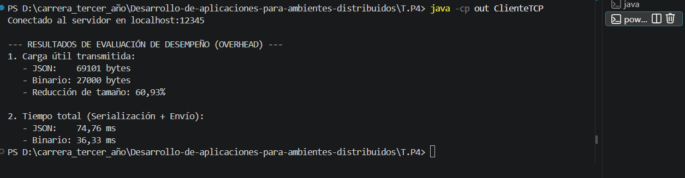
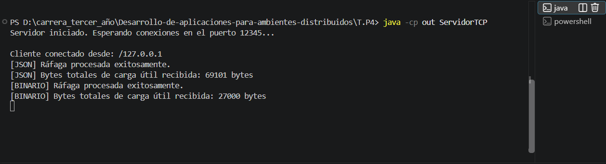

Cómo ejecutarlo
Desde la carpeta `T.P4`:

```
javac -encoding UTF-8 -d out src\*.java
java -cp out ServidorTCP     (terminal 1)
java -cp out ClienteTCP      (terminal 2)
```

## Capturas de pantalla




