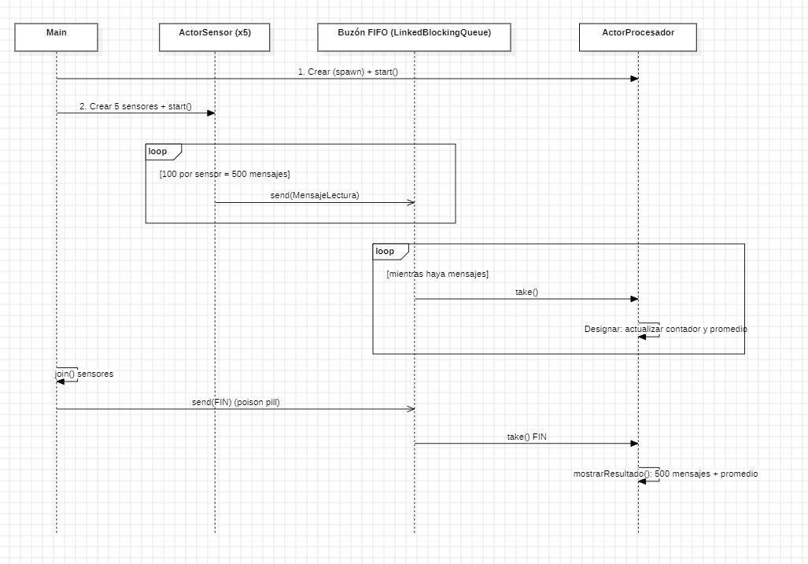
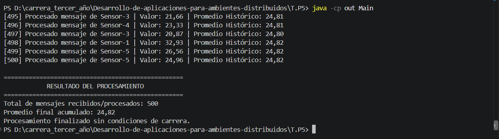

# Trabajo Práctico N° 5: Concurrencia y Sincronización con el Modelo de Actores

**Alumno:** Matías Ríos
**Docente:** Lic. Gabriel Artaza

## Descripción

Sistema concurrente basado en el modelo de actores, sin `synchronized`, sin locks y sin variables compartidas. Cinco `ActorSensor` envían 500 lecturas en total (mensajes inmutables) al buzón FIFO del `ActorProcesador`, que las procesa de a una y mantiene en privado el contador y el promedio histórico. Al final recibe un mensaje `FIN` y muestra el resultado.

## Cómo ejecutarlo

Desde la carpeta `T.P5`:

```
javac -encoding UTF-8 -d out src\*.java
java -cp out Main
```

## Diagrama de secuencia



## Ejecución en consola

