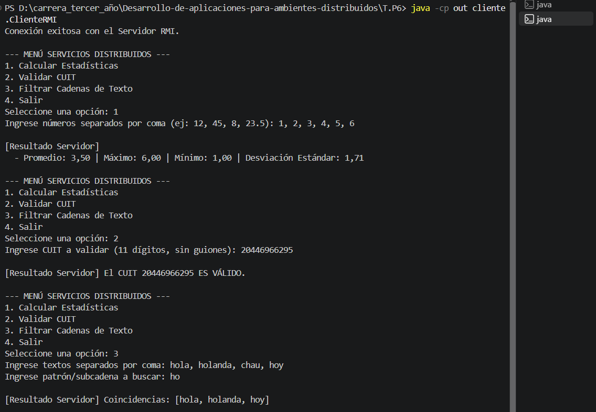
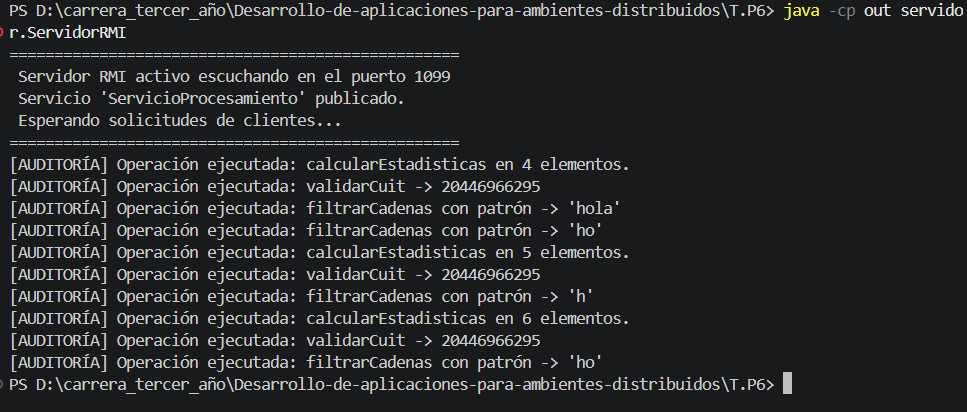

# Trabajo Práctico N° 6: Middleware y Objetos Remotos (Java RMI)

**Alumno:** Matías Ríos
**Docente:** Lic. Gabriel Artaza

## Descripción

Sistema distribuido en Java RMI donde un cliente por consola delega tareas de cómputo a un servidor remoto. El servidor publica un objeto remoto en el RMI Registry y el cliente lo usa como si fuera un objeto local, sin manejar sockets.

El servicio remoto ofrece tres operaciones:

1. **Procesamiento matemático:** recibe una lista de números y devuelve promedio, máximo, mínimo y desviación estándar.
2. **Validación de criterios:** valida un CUIT de 11 dígitos con su dígito verificador.
3. **Filtro de contenido:** recibe una lista de textos y devuelve los que contienen un patrón.

## Estructura

```
T.P6/
└── src/
    ├── servidor/
    │  ├── ServicioProcesamiento.java      Interfaz remota (extends Remote)
    │  ├── ServicioProcesamientoImpl.java  Lógica de negocio (UnicastRemoteObject)
    │  ├── Estadisticas.java               Objeto de resultado (Serializable)
    │  └── ServidorRMI.java                Crea el registry y publica el servicio
    └── cliente/
        └── ClienteRMI.java                 Menú interactivo por consola
```

- La **interfaz remota** declara los 3 métodos con `throws RemoteException`.
- **`Estadisticas`** implementa `Serializable` porque viaja por la red del servidor al cliente.
- El **servidor** muestra en consola cada operación que ejecuta (`[AUDITORÍA]`).
- El **cliente** maneja la caída del servidor con `ConnectException`.

## Cómo compilar y ejecutar

Desde la carpeta `T.P6`:

```
javac -encoding UTF-8 -d out src\servidor\*.java src\cliente\*.java
```

**Terminal 1** (servidor, se deja abierta):

```
java -cp out servidor.ServidorRMI
```

**Terminal 2** (cliente):

```
java -cp out cliente.ClienteRMI
```

En el cliente se elige una opción del menú (1 estadísticas, 2 validar CUIT, 3 filtrar textos, 4 salir) y se cargan los datos que pide.

> Si el servidor dice `Port already in use: 1099`, es porque ya hay otro servidor abierto en ese puerto. Hay que cerrarlo antes de volver a iniciarlo.

## Capturas de pantalla

### Cliente usando las 3 operaciones



### Servidor con la trazabilidad de operaciones



## Ejercicio 2: Cuestionario teórico

### 1. Abstracción del middleware

Con **sockets puros** el programador tiene que hacer todo a mano: abrir la conexión, definir un protocolo propio (qué mensaje significa cada operación), convertir los datos a bytes para enviarlos, leerlos y reconstruirlos del otro lado, y manejar los errores de red. En el TP4, por ejemplo, hubo que armar a mano el formato JSON y el binario.

Con **Java RMI** el cliente llama a un método del objeto remoto como si fuera local (`servicio.calcularEstadisticas(numeros)`). El middleware se encarga de:

- Ubicar el servicio por nombre en el registro (RMI Registry), lo que da **transparencia de localización**.
- Abrir y administrar las conexiones de red.
- Hacer el **marshalling y unmarshalling**, es decir, convertir los parámetros y el resultado (por ejemplo, el objeto `Estadisticas`) a bytes y reconstruirlos.
- Elegir qué método ejecutar en el servidor y devolver el resultado.
- Informar los fallos de comunicación como `RemoteException`.

### 2. Stub y Skeleton

- **Stub (proxy) en el cliente:** es el objeto que devuelve `registry.lookup(...)`. Implementa la misma interfaz `ServicioProcesamiento`, pero no tiene la lógica. Cuando el cliente llama a un método, el stub empaqueta (marshalling) el nombre del método y sus parámetros, los envía por la red, espera la respuesta y la desempaqueta (unmarshalling) para devolverla como si fuera una llamada local.
- **Skeleton / dispatcher en el servidor:** recibe el mensaje, desempaqueta los parámetros, llama al método real de `ServicioProcesamientoImpl` y empaqueta el resultado (o la excepción) para mandarlo de vuelta al cliente. En las versiones actuales de Java ese trabajo lo hace la propia infraestructura de RMI (`UnicastRemoteObject`), sin generar una clase skeleton aparte.

Por eso los objetos que viajan, como `Estadisticas`, tienen que implementar `Serializable`.

### 3. Manejo de fallos parciales

Si el servidor se interrumpe abruptamente, el cliente sigue funcionando, pero la llamada remota falla y lanza una excepción en lugar de devolver un resultado:

- **`java.rmi.ConnectException`**: el servidor no está disponible, por ejemplo porque se cerró antes de la llamada.
- **`java.rmi.UnmarshalException`** o **`java.rmi.MarshalException`**: la conexión se cortó en medio de la llamada, al enviar los datos o al recibir la respuesta.
- **`java.rmi.NotBoundException`**: el servicio no está publicado en el registro con ese nombre.

Todas, salvo `NotBoundException`, heredan de **`RemoteException`**. Por eso cada método de la interfaz remota la declara y el cliente está obligado a capturarla.

En un entorno productivo hay que:

- Capturar `RemoteException` en cada llamada y mostrar un mensaje claro en lugar de cortar el programa.
- Reintentar la conexión (volver a hacer el `lookup`) con un límite de intentos y una espera entre ellos.
- Configurar timeouts para no quedar bloqueado esperando una respuesta.
- Registrar los errores en un log.
- Tener en cuenta que, si la caída ocurrió durante la ejecución, no se sabe si la operación se completó en el servidor, por lo que conviene que las operaciones sean **idempotentes** (repetirlas no cambia el resultado), como las de este TP.