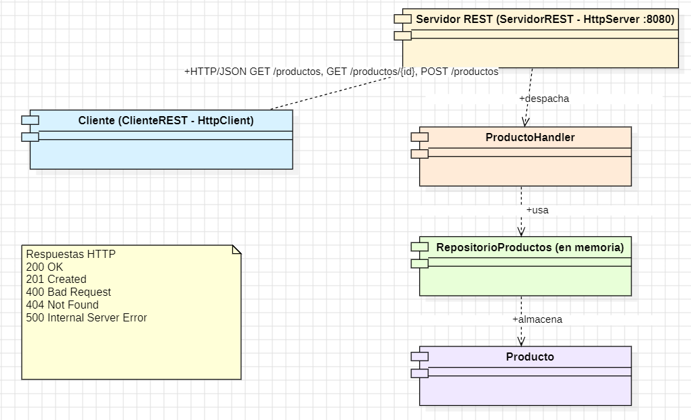
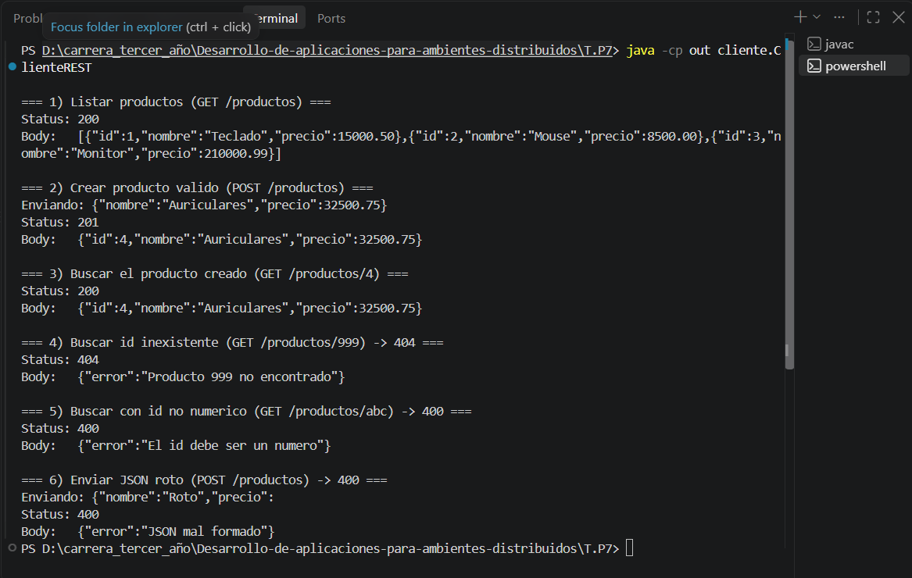
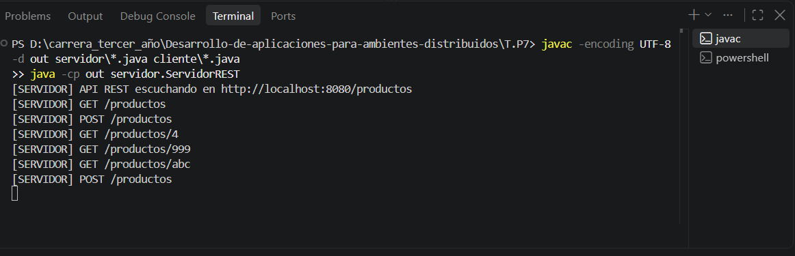

# TP7 - Integración entre Capas y Consumo de APIs / Servicios Distribuidos

- **Alumno:** Matías Ríos
- **Materia:** Desarrollo de Aplicaciones para Ambientes Distribuidos
- **Cátedra:** Lic. Gabriel Artaza
- **Unidad:** Unidad 3 - Middleware y Tecnologías de Abstracción Distribuida
- **Lenguaje y tecnologías:** Java 17+, API REST sobre HTTP/JSON con `com.sun.net.httpserver.HttpServer` (servidor) y `java.net.http.HttpClient` (cliente). Sin frameworks externos: el JSON se arma y se lee a mano (marshalling / unmarshalling).

## Descripción

Servicio distribuido de **Catálogo de Productos**. El servidor expone una API REST que permite listar, consultar y crear productos, guardados en memoria. El cliente es una aplicación de consola independiente, que corre en otro proceso, se conecta por la red al servidor, envía datos en JSON y procesa las respuestas, incluidos los errores.

## Estructura

```
T.P7/
├── servidor/
│   ├── Producto.java              (modelo + toJson / fromJson)
│   ├── RepositorioProductos.java  (almacenamiento en memoria)
│   ├── ProductoHandler.java       (atiende /productos y maneja errores)
│   └── ServidorREST.java          (main, puerto 8080)
├── cliente/
│   └── ClienteREST.java           (cliente independiente)
├── img/
└── README.md
```

## Endpoints

| Método | Ruta | Respuesta |
|---|---|---|
| GET | `/productos` | 200 con la lista de productos |
| GET | `/productos/{id}` | 200 con el producto, 404 si no existe, 400 si el id no es un número |
| POST | `/productos` | 201 con el producto creado, 400 si el JSON está mal formado o faltan campos |
| - | errores inesperados | 500 `{"error":"..."}` |

Ejemplo de payload del POST:

```json
{"nombre":"Auriculares","precio":32500.75}
```

## Diagrama de arquitectura



## Cómo ejecutar

Desde la carpeta `T.P7`:

1. Compilar:
```
javac -encoding UTF-8 -d out servidor\*.java cliente\*.java
```
2. Levantar el servidor:
```
java -cp out servidor.ServidorREST
```
3. En otra terminal, ejecutar el cliente:
```
java -cp out cliente.ClienteREST
```

## Capturas de pantalla

### Cliente: llamadas exitosas, payload JSON y manejo de errores

Los pasos 1 a 3 muestran las llamadas exitosas (200 y 201) y el JSON enviado y recibido. Los pasos 4 a 6 muestran el manejo de errores: 404 por id inexistente, 400 por id no numérico y 400 por JSON mal formado.



### Servidor: pedidos recibidos


