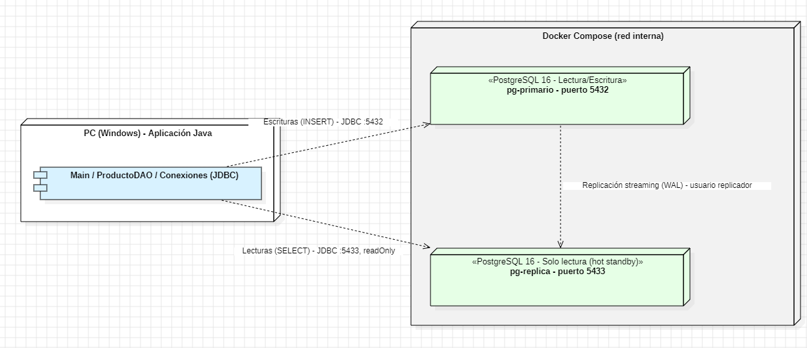
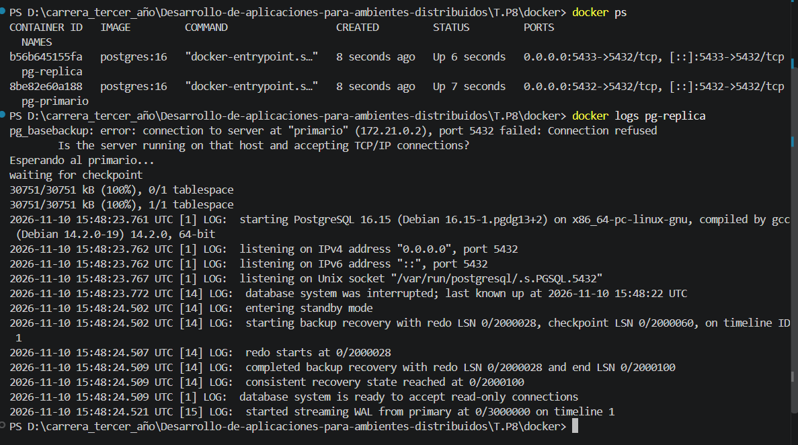
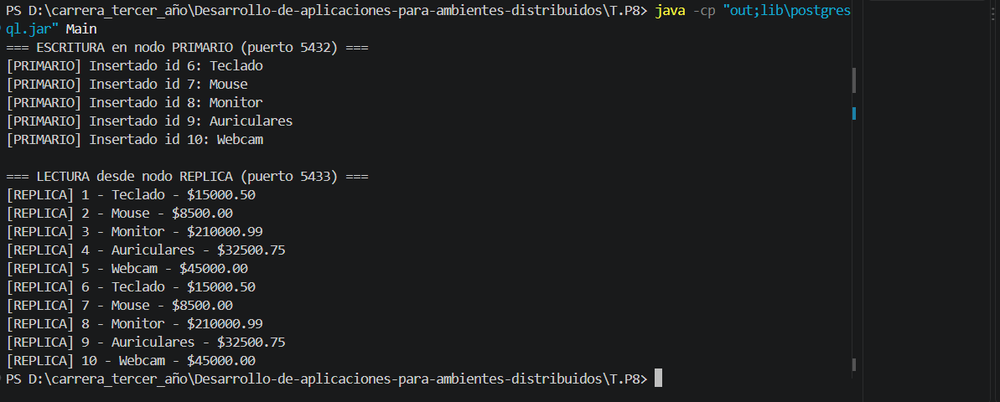
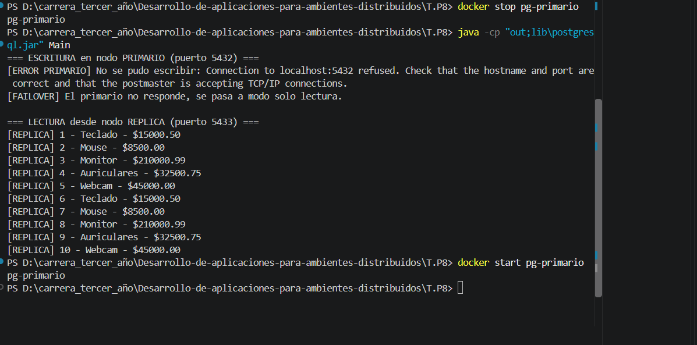

# TP8 - Bases de Datos Distribuidas y Conexión entre Capas

- **Alumno:** Matías Ríos
- **Materia:** Desarrollo de Aplicaciones para Ambientes Distribuidos
- **Cátedra:** Lic. Gabriel Artaza
- **Unidad:** Unidad 4 - Bases de Datos Distribuidas y Conexión entre Capas
- **Lenguaje y tecnologías:** Java, JDBC (driver PostgreSQL 42.7.4), PostgreSQL 16 y Docker Compose.

## Descripción

Se implementa la **Opción A (Replicación Primario / Réplica)**. Con Docker Compose se levanta un clúster de PostgreSQL 16 con dos nodos:

- **pg-primario** (puerto 5432): acepta lecturas y escrituras.
- **pg-replica** (puerto 5434): es una réplica de solo lectura (*hot standby*). Se crea con `pg_basebackup` y recibe los cambios del primario por **replicación streaming (WAL)** con el usuario `replicador`.

El backend en Java separa las cargas desde la capa de acceso a datos:

- `Conexiones.escritura()` se conecta al **primario** (5432). Ahí van los `INSERT`.
- `Conexiones.lectura()` se conecta a la **réplica** (5434), con `setReadOnly(true)`. Ahí van los `SELECT`.

`Main` inserta 5 productos en el primario, espera 1 segundo y los lee desde la réplica para verificar la propagación. Si el primario no responde, captura la `SQLException`, informa el fallo (`[ERROR PRIMARIO]` / `[FAILOVER]`) y sigue atendiendo las lecturas desde la réplica.

## Estructura

```
T.P8/
├── docker/
│   ├── docker-compose.yml   (nodos pg-primario y pg-replica)
│   └── init-primario.sh     (usuario replicador, tabla productos, pg_hba)
├── lib/
│   └── postgresql.jar       (driver JDBC)
├── src/
│   ├── Conexiones.java      (conexión de escritura y de lectura)
│   ├── ProductoDAO.java     (insertar -> primario, listar -> réplica)
│   └── Main.java            (prueba de propagación y de caída)
├── img/
└── README.md
```

## Esquema de arquitectura



## Cómo ejecutar

Requisitos: Docker Desktop abierto y Java instalado.

1. Levantar el clúster (desde `T.P8\docker`):
```
docker compose up -d
```
2. Compilar (desde `T.P8`):
```
javac -encoding UTF-8 -cp lib\postgresql.jar -d out src\*.java
```
3. Ejecutar:
```
java -cp "out;lib\postgresql.jar" Main
```
4. Simular la caída del primario y volver a ejecutar:
```
docker stop pg-primario
java -cp "out;lib\postgresql.jar" Main
docker start pg-primario
```

## Pruebas y resultados

**Propagación:** los registros insertados en el primario aparecen en la réplica en menos de 1 segundo. La replicación streaming de PostgreSQL es **asíncrona**, así que la consistencia es **eventual (perezosa)**: la réplica puede quedar un instante atrasada, pero en las pruebas siempre devolvió todos los datos.

**Caída del primario:** al detener `pg-primario`, la escritura falla con *Connection refused*. La aplicación detecta el fallo, maneja la excepción y redirige el trabajo a la réplica, que sigue respondiendo las consultas con todos los datos ya replicados. No hay promoción automática: la réplica queda en solo lectura hasta que el primario vuelve. Al hacer `docker start pg-primario`, la réplica se reconecta sola y vuelve a recibir WAL.

## Capturas de pantalla

### 1. Clúster en ejecución

`docker ps` muestra los dos nodos levantados, y los logs de la réplica muestran que está en modo solo lectura y recibiendo WAL del primario (*started streaming WAL from primary*).



### 2. Escritura en el primario y lectura en la réplica



### 3. Caída simulada del nodo primario


