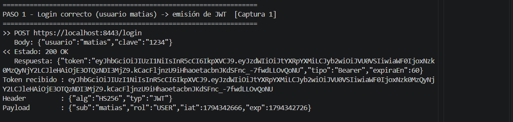
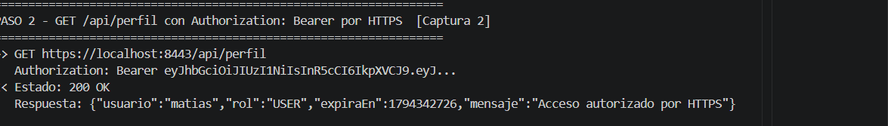
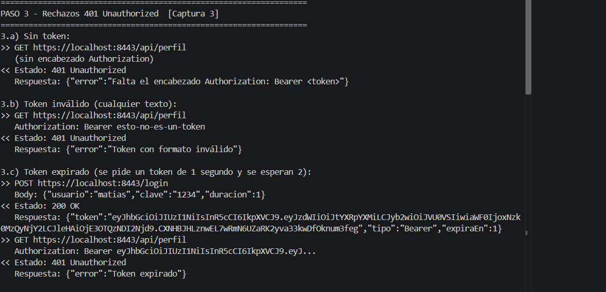
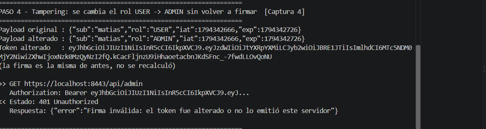

# Trabajo Práctico N° 9 - Seguridad en Aplicaciones Distribuidas (JWT y TLS/SSL)

| | |
|---|---|
| **Alumno** | Matías Ríos |
| **Materia** | Desarrollo de Aplicaciones para Ambientes Distribuidos |
| **Cátedra** | Lic. Gabriel Artaza |
| **Unidad** | Unidad 4 - Seguridad en Aplicaciones Distribuidas |
| **Lenguaje** | Java 17+ (probado con Java 25) |
| **Tecnologías** | `com.sun.net.httpserver.HttpsServer`, `java.net.http.HttpClient`, `javax.crypto.Mac` (HMAC-SHA256), `keytool` (certificado autofirmado PKCS12) |
| **Librerías externas** | Ninguna. El JWT se arma y se valida a mano para que se vea cómo funciona la firma. |

> Nota: el enunciado indica la carpeta `/TP8`, pero es un error de la consigna. El TP9 se entrega en `T.P9`, igual que los demás trabajos.

## Descripción

Se implementa una API protegida de punta a punta:

- **Canal seguro (TLS):** el servidor responde **solo por HTTPS** en el puerto `8443`, usando un certificado autofirmado generado con `keytool`. Si se intenta entrar por HTTP plano, la conexión se rechaza.
- **Autenticación (JWT):** el endpoint `POST /login` recibe usuario y clave en JSON y devuelve un token JWT firmado con **HS256** que incluye los claims `sub`, `rol`, `iat` y `exp`.
- **Autorización (middleware):** un filtro (`FiltroJwt`) intercepta las rutas protegidas, lee el encabezado `Authorization: Bearer <token>`, valida la firma y la expiración y controla el rol.
  - Token ausente, inválido o expirado: **401 Unauthorized**.
  - Token válido pero sin el rol necesario: **403 Forbidden**.
- **Prueba de tampering:** el cliente modifica el payload del token (cambia `USER` por `ADMIN`) sin volver a firmarlo, y el servidor lo rechaza porque la firma no coincide.

## Estructura

```
T.P9/
├── servidor/
│   ├── ServidorHTTPS.java          <- main: HttpsServer en 8443 con el certificado
│   ├── LoginHandler.java           <- POST /login, emite el JWT
│   ├── FiltroJwt.java              <- middleware: valida Bearer, 401 / 403
│   ├── PerfilHandler.java          <- GET /api/perfil (cualquier rol)
│   ├── AdminHandler.java           <- GET /api/admin (solo ADMIN)
│   ├── JwtUtil.java                <- crear y validar JWT (HMAC-SHA256)
│   ├── Claims.java                 <- datos del payload (sub, rol, iat, exp)
│   ├── TokenInvalidoException.java <- motivo del rechazo (formato, firma, expirado)
│   ├── Usuarios.java               <- usuarios en memoria
│   ├── Json.java                   <- lectura/armado de JSON a mano
│   └── Respuesta.java              <- envío de respuestas JSON
├── cliente/
│   └── ClienteHTTPS.java           <- pruebas automáticas (pasos 1 a 6)
├── certificados/                   <- se genera con generar-certificado.bat
├── img/                            <- capturas de pantalla
├── generar-certificado.bat
├── .gitignore
└── README.md
```

## Usuarios de prueba

| Usuario | Clave | Rol |
|---|---|---|
| `admin` | `admin123` | `ADMIN` |
| `matias` | `1234` | `USER` |

## Endpoints

| Método | Ruta | Autenticación | Rol | Respuestas |
|---|---|---|---|---|
| POST | `/login` | No (pública) | - | 200 token, 400 JSON inválido, 401 credenciales incorrectas, 405 método incorrecto |
| GET | `/api/perfil` | `Authorization: Bearer <token>` | Cualquiera | 200 OK, 401 sin token / inválido / expirado |
| GET | `/api/admin` | `Authorization: Bearer <token>` | `ADMIN` | 200 OK, 401 sin token / inválido / expirado, 403 rol sin permiso |

Cualquier otra ruta devuelve 404 y un error inesperado devuelve 500.

**Ejemplo de login:**

```
POST https://localhost:8443/login
{"usuario":"matias","clave":"1234"}
```

```json
{"token":"eyJhbGciOiJIUzI1NiIsInR5cCI6IkpXVCJ9.eyJzdWIiOi...","tipo":"Bearer","expiraEn":60}
```

El token dura **60 segundos** por defecto. En el login se puede mandar el campo opcional `"duracion"` (en segundos, entre 1 y 3600) para pedir un token más corto. El cliente lo usa para probar el caso de **token expirado**: pide un token de 1 segundo y espera 2 antes de usarlo, sin tener que esperar el minuto completo.

## Cómo funciona

### JWT (JSON Web Token)

Un JWT tiene tres partes en Base64URL separadas por puntos: `header.payload.firma`.

- **Header:** `{"alg":"HS256","typ":"JWT"}`
- **Payload (claims):** `{"sub":"matias","rol":"USER","iat":1794341318,"exp":1794341378}`
  - `sub`: usuario dueño del token.
  - `rol`: rol que se usa para autorizar.
  - `iat`: momento en que se emitió (segundos Unix).
  - `exp`: momento en que expira (segundos Unix).
- **Firma:** `HMAC-SHA256(header + "." + payload, claveSecreta)`.

El servidor es el único que conoce la clave secreta. Al validar, recalcula la firma con el header y el payload recibidos y la compara con la que trae el token (con `MessageDigest.isEqual`, en tiempo constante). Si alguien cambia aunque sea una letra del payload, la firma ya no coincide y el token se rechaza. Por eso funciona la prueba de tampering. Después de la firma se controla `exp`.

El servidor no guarda sesiones: toda la información viaja en el token (autenticación **sin estado**). La clave secreta se puede cambiar con la variable de entorno `JWT_SECRETO`.

### TLS / HTTPS

`generar-certificado.bat` usa `keytool` para crear:

- `certificados/servidor.p12`: la clave privada y el certificado autofirmado del servidor (`CN=localhost`, SAN `localhost` y `127.0.0.1`, RSA 2048, 365 días).
- `certificados/servidor.cer`: el certificado público exportado.
- `certificados/cliente-truststore.p12`: un almacén de confianza con ese certificado, para el cliente.

El servidor carga `servidor.p12` en un `SSLContext` y lo usa con `HttpsServer`, así que todo el tráfico (credenciales y tokens) viaja cifrado. El cliente **no desactiva la validación del certificado**: carga el truststore y confía solamente en ese certificado, verificando además que el nombre `localhost` coincida.

> Los archivos `.p12` y `.cer` no se suben al repositorio (están en `.gitignore`) porque tienen la clave privada. Cada uno los genera con el `.bat`.

## Instrucciones de ejecución

Requisito: JDK 17 o superior (`java`, `javac` y `keytool` en el PATH). No hay dependencias para instalar.

Todo se ejecuta desde la carpeta `T.P9`:

**1. Generar el certificado** (una sola vez):

```
generar-certificado.bat
```

**2. Compilar:**

```
javac -encoding UTF-8 -d out servidor\*.java cliente\*.java
```

**3. Levantar el servidor HTTPS:**

```
java -cp out servidor.ServidorHTTPS
```

**4. En otra terminal (también desde `T.P9`), ejecutar el cliente de pruebas:**

```
java -cp out cliente.ClienteHTTPS
```

El cliente ejecuta estos pasos y muestra la petición, el código de estado y la respuesta de cada uno:

1. Login correcto: recibe el token y muestra el header y el payload decodificados (**200**).
2. `GET /api/perfil` con el token por HTTPS (**200**).
3. Sin token, con token inválido y con token expirado (**401** en los tres casos).
4. Tampering: cambia `rol` de `USER` a `ADMIN` sin volver a firmar y llama a `/api/admin` (**401**, firma inválida).
5. `/api/admin` con el token de `matias` (**403**) y con el token de `admin` (**200**).
6. Login con clave incorrecta (**401**) e intento por HTTP plano (rechazado).

En la consola del servidor se ve cada petición: `[LOGIN]`, `[ACCESO OK]`, `[401]`, `[403]` y `[TAMPERING]`.

## Capturas de pantalla

### Captura 1 - Emisión de JWT

Petición exitosa a `POST /login` y recepción del token en formato JSON.



### Captura 2 - Acceso autorizado por HTTPS

Respuesta `200 OK` de `/api/perfil` enviando el token en el encabezado `Authorization` sobre HTTPS.



### Captura 3 - Rechazo por falta de token o expiración

Respuestas `401 Unauthorized` sin token, con token inválido y con token expirado.



### Captura 4 - Detección de tampering

Token con el payload modificado (`USER` cambiado por `ADMIN`) sin volver a firmar: el servidor detecta la firma inválida y responde `401`.


